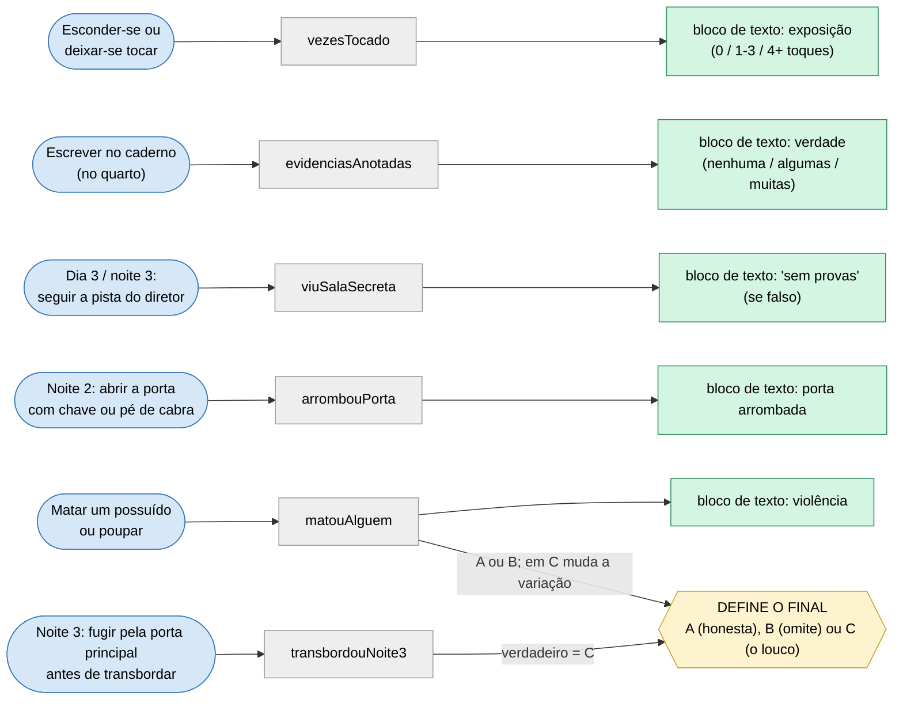
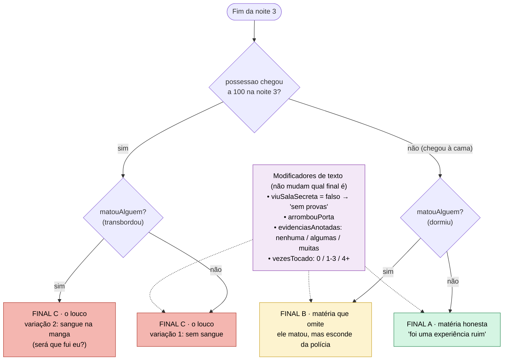
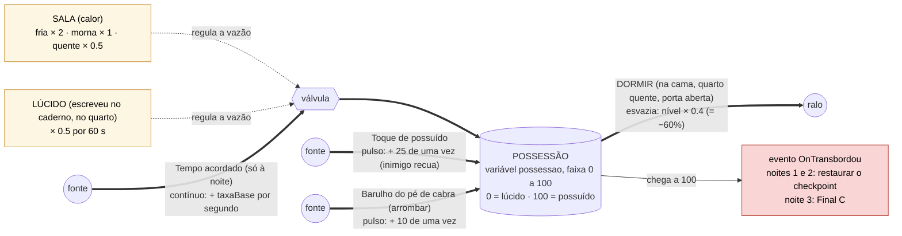
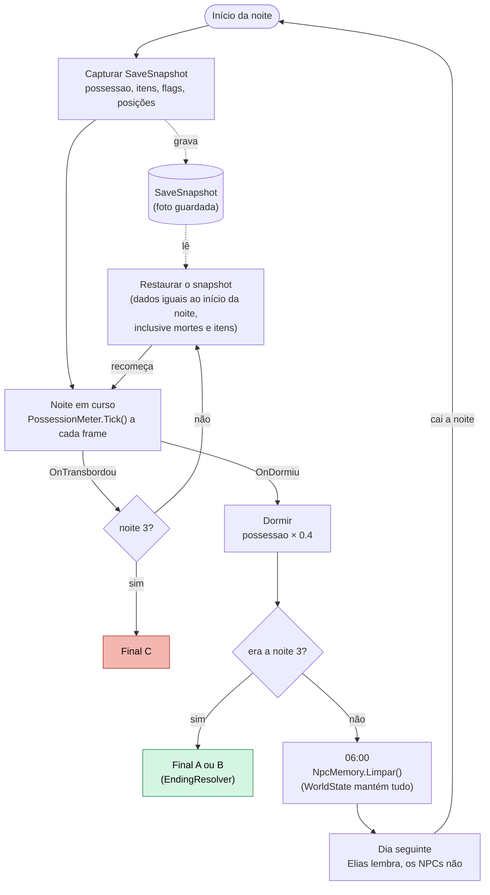
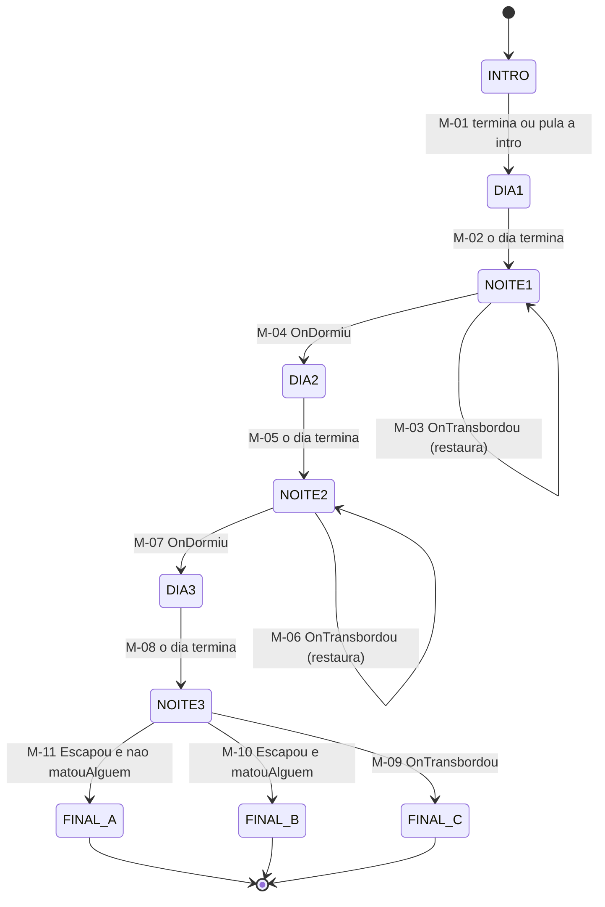
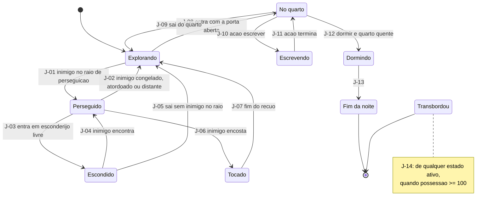
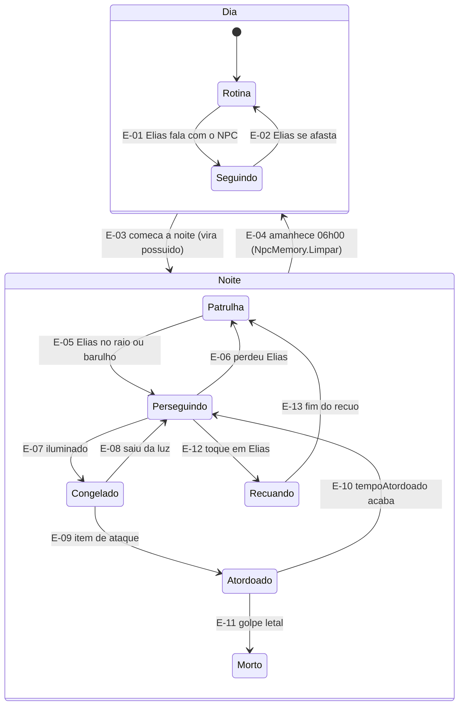
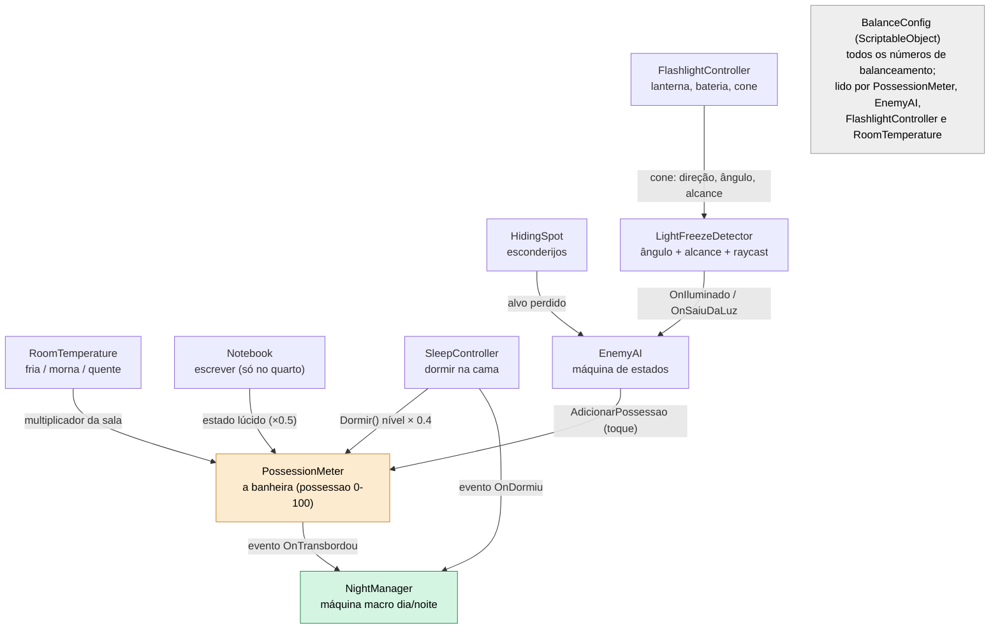
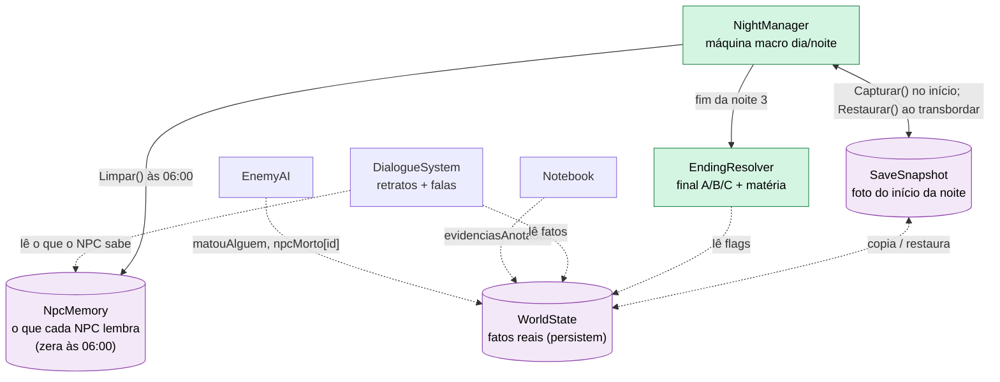

<!-- v0.2 (10/11/2026): atualizado em Markdown a partir do PDF v0.1 com as mudanças que o grupo decidiu durante o desenvolvimento. Descreve o jogo entregue. -->

# VIGÍLIA · GDD técnico v0.2

## Documento de design e guia de implementação

jogo 2D de suspense em Unity (WebGL) · Projeto 2D, Jogos Digitais, Insper 2026.2

|**Campo**|**Valor**|
|---|---|
|Disciplina|Jogos Digitais · Jogos e Interação · 2026.2 · Insper (Prof. Luciano Soares, Tec. Pedro Emil, Prof. Gustavo Braga)|
|Grupo|Vinicius Dib, Greta Faria, Enzo Christofoletti e Thomas Rudge|
|Tipo|Projeto 2D, multi developer, grupo de 4 pessoas|
|Entrega|10/11/2026 às 23:50 (enunciado do Projeto 2D): build WebGL no itch.io (jam da disciplina), repositório GitHub (com créditos no README), GDD no Milanote, e envio completo no Blackboard|
|Versão deste documento|0.2 · 10/11/2026 · atualizada com as mudanças feitas durante o desenvolvimento (tabela abaixo). A v0.1 (22/10/2026) foi consolidada a partir da conversa de design entre Enzo e Claude|
|Para quem|Grupo (leitura humana) e Claude Code (leitura por IA). Os dois usam o mesmo texto: tabelas com identificadores fixos, status explícito em cada decisão|
|Prazo do primeiro marco|Quinta, 29/10/2026: protótipo jogável de 2 noites, com paredes, salas diferentes e luz (seção 18)|

#### O que mudou da v0.1 para a v0.2 (o jogo entregue)

|**Data**|**Mudança**|**Seções**|
|---|---|---|
|24/10|Câmera vista de cima; Elias e os possuídos giram para onde olham. Cenas fixas só para o encontro com o monstro.|2, 5|
|04/11|O monstro (cena fixa) aparece **só na sala secreta**, na noite 3. Transbordar não mostra mais o monstro.|5, 10|
|04/11|**Noite 3 vira fuga:** não dá para dormir; a porta da sala secreta se abre sozinha; ao entrar, Elias encontra o monstro e precisa fugir pela porta principal, com luz de alarme e 4 possuídos extras, mais rápidos. Sair dá o final A ou B; transbordar na fuga dá o C. Resolve Q-02 e Q-17.|3, 9, 10, 11|
|04/11|Mais possuídos: 2 / 6 / 8 por noite (antes 2 / 4 / 6).|10, 14|
|04/11|Cada cômodo tem piso e móveis próprios, e o nome aparece na tela ao entrar. Música de fundo para dia, noite e fuga.|5|
|09/11|Mais difícil: a bateria dura cerca de 2 min 20 s de luz contínua (antes 4 min). Música mais baixa, passos mais altos.|7, 14|
|09/11|Jogo em **português e inglês**, com troca no menu principal.|2|
|10/11|Sala secreta definida: guarda os registros da ala de vigília; a última ficha é a de Elias (Q-01 e Q-02).|5, 12, 17|

#### Status usados em todo o documento

|**Status**|**Significa**|**Como a IA deve tratar**|
|---|---|---|
|**DECIDIDO**|O grupo decidiu. Está na conversa de design e foi aceito.|Implementar.|
|**PROPOSTA**|A IA sugeriu e ninguém contestou. O grupo ainda precisa confirmar.|Implementar atrás de configuração fácil de trocar e avisar o Enzo.|
|**ABERTO**|Ninguém decidiu. É trabalho do grupo (seção 17).|Não inventar. Deixar placeholder marcado com TODO(Q-xx) e perguntar.|
|**TESTE**|Número inicial para testar. Será calibrado jogando.|Pôr em BalanceConfig, nunca fixo no código.|

## 1. Como usar este documento

Este PDF reúne, em um lugar só, tudo o que foi decidido sobre o jogo e tudo o que ainda falta decidir. Cada diagrama tem uma versão em texto (tabela) logo abaixo, e o apêndice A traz o essencial em YAML. Se um diagrama e uma tabela divergirem, vale a tabela e o erro deve ser avisado ao Enzo.

### 1.1 Índice

|**Seção**|**Conteúdo**|**Seção**|**Conteúdo**|
|---|---|---|---|
|2|Resumo do jogo|11|Finais e matéria|
|3|Árvore de decisão (consulta rápida)|12|Pistas e escrita confusa|
|4|Glossário e identificadores|13|Arquitetura de código|
|5|Mundo e elenco|14|Flags e configuração|
|6|A banheira (possessao)|15|Decisões tomadas|
|7|Luz, bateria e ataque|16|Propostas a confirmar|
|8|Dia, noite e memória|17|Em aberto (trabalho do grupo)|
|9|Máquinas de estado|18|Sprints e rubricas|
|10|As três noites|19|Definição de pronto · Apêndice A (YAML)|

### 1.2 Regras para o Claude Code

- **Fonte da verdade:** este documento. Se faltar informação, não invente: pergunte.

- **Itens ABERTO:** criar placeholder com comentário `// TODO(Q-xx)` e seguir com o resto. Itens PROPOSTA: implementar atrás de configuração e avisar.

- **Nenhum número de balanceamento no código.** Tudo vai para o ScriptableObject `BalanceConfig` (seção 14.2).

- **Nomes exatos:** usar os identificadores do glossário (seção 4), em português sem acento, camelCase, eventos com prefixo `On`.

- **Uma única porta de entrada para possessao:** só o PossessionMeter escreve nessa variável (AdicionarPossessao, Dormir, DefinirValor para restaurar checkpoint).

- **Máquinas de estado:** enum + switch + método MudarEstado(novo) com ações de entrada e saída. As transições são as tabelas da seção 9, linha por linha.

- **O Enzo quer entender o código.** Implemente em passos pequenos e testáveis, explique o porquê de cada escolha em poucas frases, e aponte onde ele deve olhar para aprender. Ele vai conduzir o aprendizado com o Claude Code.

- **Compatível com WebGL** (seção 13.4): sem threads, sem acesso direto a arquivos, áudio só depois de um clique.

- **Créditos:** assets e trechos de código de terceiros entram no README. A disciplina exige crédito quando se copia mais de 2 ou 3 linhas, e proíbe copiar código de colegas.

- **Antes de dizer que terminou** uma tarefa, passar pela lista “Definição de pronto” (seção 19).

## 2. Resumo do jogo

**VIGÍLIA** é um jogo 2D de suspense, visto de cima, em Unity (build WebGL, publicado no itch.io, em português e inglês). Elias Vaughn, jornalista, passa um fim de semana (3 dias e 3 noites) em um sanatório isolado no Alasca para investigar relatos de que internos e funcionários “esquecem” tudo a cada amanhecer. Ele descobre a regra por trás disso: **quem não dorme é possuído**. À noite, os possuídos andam até ele e só param enquanto a luz da lanterna os ilumina. Elias precisa chegar à cama e dormir antes que a possessão atinja o limite. Na terceira noite não há sono: uma porta se abre no subsolo, algo espera lá dentro, e Elias precisa fugir do sanatório. No fim ele escreve a matéria, e o que escreve depende do que fez.

### 2.1 Pilares

- **Luz é mecânica.** A tela é escura; só se vê o que a lanterna toca, e só o que a lanterna ilumina fica parado.

- **Sono é a única saída.** Um estoque único, `possessao`, mede o risco. Todo o resto (inimigos, porta trancada, bateria, frio) é obstáculo entre Elias e a cama.

- **Memória é o tema.** O mundo esquece às 06:00, só Elias lembra, e a matéria é o único registro confiável.

- **Escopo curto e polido.** 3 noites, uma ala do sanatório, 2 tipos de inimigo. Um jogo menor e acabado vale mais que um grande e quebrado (a rubrica pede “completo e bem acabado”).

### 2.2 Dentro e fora do escopo

|**Dentro do escopo**|**Fora do escopo (cortado)**|
|---|---|
|Lanterna com cone, congelar inimigos, bateria|IA ou LLM em tempo real (decisão D-01)|
|Banheira (possessao) com frio, toque, barulho, sono e caderno|Fome (proposta P-01)|
|3 dias (hub de conversa) e 3 noites (ação)|Cenas explícitas de morte ou de autolesão (seção 10, Q-15)|
|Esconderijos, itens de ataque, pé de cabra e chave|Vários mapas ou alas|
|Retratos de diálogo com olheiras|Multiplayer |
|Checkpoint por noite e reset das 06:00|Árvore de diálogo ramificada com dezenas de falas|
|3 finais com matéria montada por blocos de texto||
|Fuga da noite 3, com o monstro na sala secreta (v0.2)||
|Português e inglês, com troca no menu (v0.2)||

## 3. Árvore de decisão (consulta rápida)

Seção para quando ninguém lembrar de uma decisão. Leia da esquerda para a direita: **ação do jogador → flag que ela liga → o que muda no final e na matéria**. Os nomes das flags estão no glossário (seção 4) e na tabela da seção 14.1.

### 3.1 O que cada ação do jogador liga



_Figura 1 · Ações do jogador (azul), flags (cinza) e saídas (verde e amarelo). Versão em texto na tabela 3.3._

### 3.2 Como o final é escolhido



> No original, as setas tracejadas dos modificadores vão para todos os finais (C, B e A).

_Figura 2 · Árvore dos finais. O final é função apenas de transbordouNoite3 e matouAlguem; os modificadores só mudam blocos de texto._

### 3.3 Versão em texto: regra de resolução do final

|**Regra**|**transbordouNoite3**|**matouAlguem**|**Final**|**Variação**|
|---|---|---|---|---|
|R-1|falso|falso|A · matéria honesta|—|
|R-2|falso|verdadeiro|B · matéria que omite|—|
|R-3|verdadeiro|falso|C · o jornalista é o louco|variação 1: sem sangue|
|R-4|verdadeiro|verdadeiro|C · o jornalista é o louco|variação 2: sangue na manga (“fui eu?”)|

Modificadores (não mudam o final, só acrescentam blocos de texto à matéria): `viuSalaSecreta = falso` acrescenta o bloco “sem provas”; `arrombouPorta = verdadeiro` acrescenta o bloco “porta arrombada”; `evidenciasAnotadas` escolhe o bloco de verdade (nenhuma, algumas, muitas); `vezesTocado` escolhe o bloco de exposição (0, 1 a 3, 4 ou mais).

### 3.4 Cola rápida: escolha → consequência → efeito no final

|**Momento**|**Escolha do jogador**|**Consequência imediata**|**Efeito no final**|
|---|---|---|---|
|Qualquer noite|Matar um possuído (ou poupar)|matouAlguem = verdadeiro; npcMorto[id] = verdadeiro; no dia seguinte os NPCs negam que a pessoa existiu. Repetir a noite (checkpoint) desfaz a morte|Final B se dormir na noite 3; Final C variação 2 se transbordar na noite 3|
|Qualquer noite|Esconder-se ou ser tocado|Cada toque soma +25 em possessao e incrementa vezesTocado|Só texto: bloco de exposição|
|Qualquer noite, no quarto|Escrever no caderno|Evidências coletadas viram evidenciasAnotadas (P-07); ativa o estado lúcido (× 0.5 por 60 s)|Só texto: bloco de verdade|
|Noite 1|Achar o cobertor|temCobertor = verdadeiro; o quarto fica quente; passa a ser possível dormir (P-05)|Nenhum direto|
|Noite 2|Abrir a porta com chave ou pé de cabra|Chave: gasta tempo. Pé de cabra: rápido, +10 em possessao, arrombouPorta = verdadeiro|Só texto: bloco “porta arrombada”|
|Dia 3 e noite 3|Seguir a pista do diretor até a sala secreta|viuSalaSecreta = verdadeiro|Só texto: sem esta flag a matéria sai “sem provas”|
|Noite 3|Entrar na sala secreta, encontrar o monstro e fugir pela porta principal antes de transbordar (v0.2)|Sair leva a A ou B. Transbordar leva a C (a noite 3 não repete)|Decide A ou B versus C|

## 4. Glossário e identificadores

Cada termo é definido uma vez e usado sempre igual, no texto, nas tabelas e no código.

|**Termo**|**Identificador**|**Definição**|
|---|---|---|
|Possessão (a banheira)|possessao|float de 0 a 100: quanto Elias já está possuído. 100 = possuído. Única variável de risco do jogo.|
|Transbordar|OnTransbordou|Evento disparado uma vez por noite quando possessao chega a 100.|
|Vazão base|taxaBase|Quanto possessao sobe por segundo enquanto Elias está acordado à noite.|
|Temperatura da sala|TemperaturaSala {Fria, Morna, Quente}|Atributo de cada sala. Multiplica a vazão base (multFria, multMorna, multQuente).|
|Lúcido|lucido|Estado temporário depois de escrever no caderno. Multiplica a vazão por multLucido durante duracaoLucido.|
|Pulso|AdicionarPossessao(x)|Soma de uma vez em possessao (toque: pulsoToque; barulho: pulsoBarulho).|
|Dormir|Dormir(), OnDormiu|Ação na cama (quarto quente, porta aberta). possessao passa a possessao × fatorSono (0.4).|
|Quarto (porto seguro)|quarto|Sala de Elias: inimigos não entram (P-06), é onde ele escreve e dorme.|
|Caderno|Notebook|Ação de escrever, só no quarto. Anota evidências e deixa Elias lúcido.|
|Evidência|evidenciasColetadas, evidenciasAnotadas|Itens de prova. Só contam para a matéria depois de anotados (P-07).|
|WorldState|mundo|Fatos reais do jogo. Persistem entre dias e noites.|
|NpcMemory|memoriaNpc|O que cada NPC lembra. Zerada às 06:00.|
|Checkpoint|SaveSnapshot|Cópia profunda do estado no início de cada noite. Restaurada quando se transborda nas noites 1 e 2.|
|Toque|OnToque|Contato de um possuído com Elias: soma pulsoToque e o inimigo recua.|
|Congelado|Congelado|Estado do inimigo enquanto está iluminado (4 condições, seção 7.1).|
|Bateria|bateria|float 0 a 100. Cai enquanto a lanterna está ligada. Com 0, a lanterna apaga e nada congela.|
|Matéria|Materia|Texto final montado por blocos escolhidos pelas flags.|
|Final A, B, C|FinalMateria.Honesta, Omite, Louco|Os três finais (seção 11).|
|Funcionário possuído|tipoFuncionario|Inimigo de velocidade normal que patrulha e persegue.|
|Paciente velho|tipoPacienteVelho|Inimigo mais rápido, errático, que reage a barulho.|

## 5. Mundo e elenco

### 5.1 Ambientação

O jogo é visto de cima **DECIDIDO** (24/10): Elias e os possuídos giram para onde olham, e cada cômodo tem piso, móveis e nome próprios. Cenas fixas só para o encontro com o monstro.

Um sanatório isolado no interior do Alasca, em pleno inverno (nome provisório: **Sanatório St. Brenna**, P-11). No Alasca de inverno os dias são curtos e as noites longas, e é por isso que a maior parte do jogo acontece à noite. Há neve, vidro congelado, vapor da respiração e aquecimento precário. A estética é um “Outlast em 2D”: o espaço fica escuro e só é visto onde a lanterna toca. **DECIDIDO**

**Regra de lore (DECIDIDO):** quem não dorme é possuído. Ao amanhecer, às 06:00, todos esquecem o que aconteceu durante a noite; só Elias lembra. Todos os retratos têm olheiras profundas, para o jogador ler o tema só de olhar. A regra é explicada na intro do jogo, que é obrigatória (a justiça dos finais depende de o jogador ter ouvido a regra).

**Lore (v0.2):** atrás do arquivo do subsolo fica a sala secreta do Dr. Holt. Ela guarda os registros da ala de vigília: gráficos de horas de sono por interno, noite após noite, e nomes riscados um por um. O último nome não está riscado; é o de Elias, numa ficha com a letra dele e a anotação do diretor: “Acredita ser jornalista. Deixar que escreva. Escrever o acalma.” Na noite 3 a porta se abre sozinha e algo espera lá dentro: o monstro (cena fixa). A origem do espírito continua sem explicação, de propósito.

### 5.2 Elenco (nomes definidos nesta versão, P-11)

|**Nome**|**Papel**|**De dia**|**De noite**|**Função no jogo**|
|---|---|---|---|---|
|Elias Vaughn|Jornalista, protagonista (o jogador)|—|—|Único que lembra. Escreve a matéria.|
|Marta Quill|Enfermeira-chefe|Cordial, faz conversas estranhas. Chama Elias pelo nome antes de ele se apresentar (pista 1).|Possuída: segue devagar e sussurra.|Inimigo tipo funcionário.|
|Otis Brandt|Zelador|Simpático, dá dicas do prédio. Tem a oficina onde fica o pé de cabra.|Possuído: segue.|Inimigo tipo funcionário. O pé de cabra nunca depende dele estar vivo.|
|Dr. Henrik Almeida|Médico|Evasivo. Guarda uma evidência importante.|Possuído.|Vítima possível. Se morrer, os outros negam que ele existiu.|
|Sr. Wren|Paciente idoso|Calmo, murmura frases sem sentido.|Possuído: caçador mais rápido, reage a barulho.|Inimigo tipo paciente velho.|
|Dr. Alaric Holt|Diretor do sanatório|Cordial e paternal.|Não aparece; na noite 3 a sala secreta dele revela os registros da ala de vigília.|Vilão. Mantém os internos acordados de propósito (frio, plantões).|
|O monstro|O que espera na sala secreta|—|Aparece uma vez, na noite 3, em cena fixa; depois dele, a fuga.|Clímax do jogo (v0.2).|
|Pacientes figurantes|Variações de sprite|Rotina nos corredores.|Possuídos.|Enchem o mapa sem custo de retrato.|

### 5.3 Retratos de diálogo

Durante as conversas, aparece ao lado do texto um retrato do personagem, no estilo das caixas de diálogo de Pokémon, com muita olheira **DECIDIDO**. Proposta **PROPOSTA**: 2 variantes por personagem (dia lúcido e noite possuída), cerca de 10 retratos no total. Os retratos em 3D ao lado de um mundo 2D podem destoar: o grupo deve combinar uma paleta ou um filtro em comum (Q-11).

## 6. A banheira (possessao)

### 6.1 O que ela mede

A banheira **quantifica o quanto Elias já está possuído**. É uma única variável, `possessao`, de 0 a 100. Pense numa banheira: o nível da água é a possessão, e se a água transbordar (100) o espírito vence. Ela não é “vida”: não existe barra de vida. Existe só o risco de ser possuído.

- **Torneiras (enchem):** tempo acordado à noite, toque de possuído, barulho do pé de cabra.

- **Registros (regulam a vazão da torneira do tempo):** a temperatura da sala (fria dobra, quente divide por dois) e o estado lúcido depois de escrever no caderno.

- **Ralo (esvazia):** dormir, que reduz o nível em 60%.

- **O calor e o sono não são barras separadas.** O sono é uma ação que esvazia; o calor é uma condição que muda a velocidade com que a água sobe.

- **Como o jogador vê o nível (P-10):** sem barra de HUD. O mundo avisa: vinheta escura nas bordas da tela, olheira no retrato de Elias, batimento sonoro e tremor da lanterna crescem com o nível. A barra opcional fica em aberto (Q-13).

### 6.2 Diagrama de estoque e fluxos



> **Herança:** ao dormir, o que sobra (40% do nível) passa para a noite seguinte. Se transbordar nas noites 1 e 2, a noite recomeça com o valor que tinha no início dela (checkpoint).

_Figura 3 · Estoque e fluxos da possessão. Versão em texto na tabela 6.3._

### 6.3 Versão em texto: fluxos

|**Fluxo**|**Tipo**|**Efeito em possessao**|**Valor inicial**|**Status**|
|---|---|---|---|---|
|Tempo acordado (só à noite)|contínuo|+ taxaBase × multSala × multLucido por segundo|taxaBase 0.10 por segundo **TESTE**|**DECIDIDO** (existe); **PROPOSTA** (só à noite, P-04)|
|Frio ou calor da sala|multiplicador|fria × 2, morna × 1, quente × 0.5 sobre a vazão base|multFria 2.0, multMorna 1.0, multQuente 0.5 **TESTE**|**DECIDIDO**|
|Toque de possuído|pulso|+ pulsoToque de uma vez; o inimigo recua|pulsoToque 25 **TESTE**|**DECIDIDO**|
|Barulho do pé de cabra (arrombar)|pulso|+ pulsoBarulho de uma vez; arrombouPorta = verdadeiro|pulsoBarulho 10 **TESTE**|**PROPOSTA** (P-03)|
|Escrever no caderno (lúcido)|multiplicador temporário|multLucido sobre a vazão base por duracaoLucido|multLucido 0.5; duracaoLucido 60 s **TESTE**|**DECIDIDO**|
|Dormir|esvazia|possessao passa a possessao × fatorSono|fatorSono 0.4 (esvazia 60%)|**DECIDIDO** (60%, D-09)|

### 6.4 Cálculo a cada quadro e exemplo numérico

Ordem de operações no PossessionMeter, a cada quadro, quando for noite:

- 1. calcular multSala (da sala atual) e multLucido (1.0 ou o valor do estado lúcido);

- 2. possessao = possessao + taxaBase × multSala × multLucido × dt;

- 3. limitar o valor ao intervalo de 0 a 100;

- 4. se possessao ≥ 100 e ainda não transbordou nesta noite: disparar OnTransbordou uma única vez.

**Exemplo.** Elias termina a noite 1 com possessao 70 e dorme: 70 × 0.4 = **28**. A noite 2 começa com 28. Com taxaBase 0.10 por segundo, em sala morna sobe 6 por minuto, em sala fria 12 por minuto e em sala quente 3 por minuto. Se levar um toque (+25) e chegar à cama com 63, dormir deixa 25.2 para a noite 3. Quem jogou bem acorda leve; quem foi tocado muitas vezes carrega uma cicatriz. Isso torna o “único que não reseta” uma mecânica.

### 6.5 Transbordar e checkpoint

|**Situação**|**O que acontece**|**Status**|
|---|---|---|
|Início de cada noite|O NightManager captura o SaveSnapshot: possessao, itens, flags, posições e NpcMemory (cópia profunda).|**DECIDIDO**|
|Transbordar nas noites 1 e 2|Restaura o snapshot. Os dados ficam iguais aos do início da noite, inclusive mortes e itens, e a noite recomeça. Mostrar feedback claro (tela e som) antes de repetir.|**DECIDIDO**|
|Transbordar na noite 3|Não repete. Leva ao Final C.|**PROPOSTA** (P-02)|
|Dormir|possessao × 0.4. Às 06:00 NpcMemory é zerada. WorldState é mantido. Começa o dia seguinte.|**DECIDIDO**|
|Entre noites|possessao acumula (herda o que sobrou). Não há teto de herança: com fatorSono 0.4, o máximo herdado é 40.|**DECIDIDO**|

### 6.6 Proteções contra espiral da morte (rubrica 11)

- O checkpoint é no **início** da noite, então repetir nunca começa pior do que a noite começou.

- Dormir esvazia 60%, então herdar nunca passa de 40 e sempre há margem para vencer a noite seguinte.

- A noite não tem cronômetro: ela só acaba por sono ou transbordo. Como a possessão sobe com o tempo, o jogador não consegue ficar parado para sempre sem consequência.

- Na noite 2 há uma sala quente (aquecedor) no caminho, para o jogador nunca ficar a noite inteira sem alívio.

### 6.7 Condição para dormir (P-05) e por que Elias sai do quarto

Proposta **PROPOSTA**: **só é possível dormir com o quarto quente e a porta aberta**. É isso que obriga Elias a sair do quarto: na noite 1 o quarto é frio por falta de cobertor; na noite 2 ele fica trancado fora. A noite 3 ainda não tem o motivo definido (Q-17). Sugestão para o grupo avaliar: a caldeira falha, o quarto esfria, e religá-la exige ir ao subsolo, onde está a sala secreta do diretor.

## 7. Luz, bateria e ataque

### 7.1 Congelar inimigos: lógica, não pixels

A luz que o jogador vê (Light 2D da URP) é só a aparência. Quem decide se um inimigo para é a **lógica**, em um script próprio (LightFreezeDetector). Analogia: a luz é a pintura e a lógica é a planta da casa; o jogo decide pela planta. Um inimigo está **iluminado** quando as quatro condições são verdadeiras ao mesmo tempo:

- 1. distância entre Elias e o inimigo ≤ alcance da lanterna;

- 2. ângulo entre a direção da lanterna e a direção do inimigo ≤ meia abertura do cone;

- 3. um raycast de Elias até o inimigo não encontra parede;

- 4. a lanterna está ligada e bateria > 0.

```text
 Teste de "está iluminado?" (lógica, não pixels)

                       (B) fora do ângulo → continua andando
                    /
                  /   meia abertura
   Elias ●  ──►  <     (A)      ┃parede      (D) além do alcance → continua andando
                  \            ┃  ·····(C) parede no raycast → continua andando
                    \
   |←────────── alcance (distância máxima) ──────────→|

   A: passa nos 4 testes → CONGELA
```

Figura 4 (descrição): Elias aponta a lanterna; o cone tem uma meia abertura e um alcance.
- **A** está dentro do cone, dentro do alcance e sem parede no caminho → **congela**.
- **B** está fora do ângulo → continua andando.
- **C** está dentro do cone, mas o raycast bate numa parede → continua andando.
- **D** está além do alcance → continua andando.

_Figura 4 · Teste de iluminação: só o inimigo A passa nos quatro testes e congela._

### 7.2 Bateria

A lanterna tem bateria **DECIDIDO**. Ela cai enquanto a lanterna está ligada. Com 0, a luz apaga e os inimigos não param mais. Pilhas encontradas no mapa recarregam. Regra anti dead end **PROPOSTA**: sempre existe ao menos uma pilha alcançável em cada noite. Valores (consumo por segundo, recarga por pilha, quantas pilhas por noite) são **TESTE** e estão em BalanceConfig. Na v0.2 o consumo subiu para 0.7 por segundo (a bateria cheia dura cerca de 2 min 20 s de luz contínua), para a luz ser um recurso a administrar.

### 7.3 Ataque

Elias pode atacar com itens encontrados no mapa **DECIDIDO** (decisão D-21), e matar tem consequência permanente: `matouAlguem`. **Como** o ataque funciona está **ABERTO** (Q-04). Implementado (v0.2): o **sedativo** (tecla Q) atordoa um possuído congelado na luz, bem perto; sobre um possuído atordoado, a **chave inglesa** (tecla R, duas vezes, com confirmação) dá o golpe letal. Um de cada por noite, para a luz continuar sendo a defesa principal e o ataque ser uma escolha moral (a base dos finais B e C).

## 8. Dia, noite e memória

### 8.1 O dia

O dia é um hub tranquilo **DECIDIDO**: os funcionários são inofensivos, conversam de forma esquisita e às vezes seguem Elias. Não há perseguição. Proposta **PROPOSTA** (P-04): possessao não sobe de dia. Elias explora, conversa, coleta pistas e pode escrever no caderno, mas só no quarto. Como o dia termina (tempo ou ação) está em aberto (Q-18). Dias são baratos de produzir; a ação fica nas noites.

### 8.2 Dois cadernos: o mundo lembra, os NPCs esquecem

||**WorldState (mundo)**|**NpcMemory (memória dos NPCs)**|
|---|---|---|
|O que guarda|Fatos reais: matouAlguem, npcMorto, itens, evidências, flags de pista|O que cada NPC sabe ter visto ou ouvido|
|Reset às 06:00|Nunca|Sempre (NpcMemory.Limpar())|
|Quem lê|EndingResolver, DialogueSystem, EnemyAI, SleepController|DialogueSystem|
|Quem escreve|EnemyAI, Notebook, gatilhos de pista, portas, itens|DialogueSystem e eventos que um NPC presenciou|
|No SaveSnapshot|Sim|Sim|

### 8.3 Regra de diálogo

O DialogueSystem escolhe a linha combinando os dois cadernos: se um fato existe em WorldState mas o NPC não o tem em NpcMemory, ele age como se nunca tivesse acontecido. Se `npcMorto[x]` é verdadeiro, os NPCs de dia negam que x existiu (“Dr. Almeida? Não conheço nenhum Almeida”). O estranhamento do jogador vira pista. As falas de cada NPC para cada fato são trabalho de roteiro (Q-19).

### 8.4 Ciclo da noite: checkpoint, transbordo, sono e reset



_Figura 5 · Ciclo de uma noite. Versão em texto nas tabelas 6.5 e 9.1._

## 9. Máquinas de estado

Há três máquinas encaixadas, como três mapas de metrô: o **macro** (o fim de semana), a do **jogador dentro de uma noite** e a de **cada inimigo**. Cada estado é uma estação e cada seta é uma transição com condição. As máquinas só **leem** o caderno de fatos (WorldState); o final é uma função dele. Implementação sugerida: um `enum` de estados, um `switch` e um método `MudarEstado(novo)` com ações de entrada e saída. Refatore para outro padrão só depois de funcionar.

### 9.1 Máquina macro (o fim de semana)



_Figura 6 · Máquina macro. Dias são hubs; noites são a ação; transbordar nas noites 1 e 2 repete a noite._

#### Versão em texto: transições da máquina macro

|**ID**|**De**|**Para**|**Condição**|**Efeito**|
|---|---|---|---|---|
|M-01|INTRO|DIA 1|jogador termina ou pula a intro|WorldState inicial; noiteAtual = 1|
|M-02|DIA 1|NOITE 1|o dia termina (Q-18)|capturar SaveSnapshot|
|M-03|NOITE 1|NOITE 1|OnTransbordou|restaurar SaveSnapshot e recomeçar a noite|
|M-04|NOITE 1|DIA 2|OnDormiu|possessao × fatorSono; NpcMemory.Limpar() às 06:00; noiteAtual = 2|
|M-05|DIA 2|NOITE 2|o dia termina|capturar SaveSnapshot|
|M-06|NOITE 2|NOITE 2|OnTransbordou|restaurar SaveSnapshot e recomeçar a noite|
|M-07|NOITE 2|DIA 3|OnDormiu|possessao × fatorSono; NpcMemory.Limpar(); noiteAtual = 3|
|M-08|DIA 3|NOITE 3|o dia termina|capturar SaveSnapshot|
|M-09|NOITE 3|FINAL C|OnTransbordou|transbordouNoite3 = verdadeiro; EndingResolver|
|M-10|NOITE 3|FINAL B|Escapou (saiu pela porta principal na fuga, v0.2) e matouAlguem = verdadeiro|EndingResolver|
|M-11|NOITE 3|FINAL A|Escapou (saiu pela porta principal na fuga, v0.2) e matouAlguem = falso|EndingResolver|

### 9.2 Jogador dentro de uma noite



_Figura 7 · Estados do jogador durante uma noite (possessao menor que 100)._

#### Versão em texto: transições do jogador

|**ID**|**De**|**Para**|**Condição**|**Efeito**|
|---|---|---|---|---|
|J-01|Explorando|Perseguido|algum inimigo entra no raio de perseguição|—|
|J-02|Perseguido|Explorando|inimigo congelado, atordoado ou distante|—|
|J-03|Perseguido|Escondido|Elias entra em esconderijo livre (Q-07)|inimigos perdem o alvo|
|J-04|Escondido|Perseguido|inimigo encontra (barulho ou tempo máximo, Q-07)|—|
|J-05|Escondido|Explorando|Elias sai e nenhum inimigo está no raio|—|
|J-06|Perseguido|Tocado|inimigo encosta em Elias|AdicionarPossessao(pulsoToque); vezesTocado + 1; inimigo vai a Recuando|
|J-07|Tocado|Explorando|fim do recuo|—|
|J-08|Explorando|No quarto|Elias entra no quarto com a porta aberta|inimigos não entram (P-06)|
|J-09|No quarto|Explorando|Elias sai do quarto|—|
|J-10|No quarto|Escrevendo|ação escrever|evidenciasColetadas passam a evidenciasAnotadas; lúcido por duracaoLucido|
|J-11|Escrevendo|No quarto|ação termina|—|
|J-12|No quarto|Dormindo|ação dormir e quarto quente (P-05)|dispara OnDormiu|
|J-13|Dormindo|Fim da noite|—|possessao × fatorSono; amanhecer 06:00|
|J-14|qualquer estado ativo|Transbordou|possessao ≥ 100|dispara OnTransbordou; noites 1 e 2 restauram checkpoint, noite 3 leva ao Final C|

### 9.3 Inimigo (funcionário possuído e paciente velho)



> E-03 vai de Rotina ou Seguindo para **Patrulha**; E-04 vai de qualquer estado da noite para **Rotina**.

_Figura 8 · Estados do inimigo. De dia é inofensivo; à noite é possuído._

#### Versão em texto: transições do inimigo

|**ID**|**De**|**Para**|**Condição**|**Efeito**|
|---|---|---|---|---|
|E-01|Rotina|Seguindo|Elias fala com o NPC (ou o NPC decide seguir)|conversa estranha|
|E-02|Seguindo|Rotina|Elias se afasta|—|
|E-03|Rotina ou Seguindo|Patrulha|começa a noite|vira possuído|
|E-04|qualquer estado da noite|Rotina|amanhece às 06:00|NpcMemory.Limpar(): esquece tudo|
|E-05|Patrulha|Perseguindo|Elias no raio de detecção ou barulho|—|
|E-06|Perseguindo|Patrulha|perdeu Elias (esconderijo ou distância)|—|
|E-07|Perseguindo|Congelado|iluminado: alcance, ângulo, sem parede, bateria maior que 0|para de andar|
|E-08|Congelado|Perseguindo|saiu da luz|—|
|E-09|Congelado|Atordoado|item de ataque (Q-04)|—|
|E-10|Atordoado|Perseguindo|tempoAtordoado acaba|—|
|E-11|Atordoado|Morto|golpe letal (Q-04)|matouAlguem = verdadeiro; npcMorto[id] = verdadeiro|
|E-12|Perseguindo|Recuando|encosta em Elias (toque)|Elias recebe pulsoToque|
|E-13|Recuando|Patrulha|fim do recuo|—|

## 10. As três noites

A dificuldade sobe de uma noite para a outra por **alavancas concretas** (número de inimigos, velocidade, esconderijos, pilhas, salas quentes). Os valores das alavancas são **TESTE** e vivem em BalanceConfig.

|**Aspecto**|**Noite 1**|**Noite 2**|**Noite 3**|
|---|---|---|---|
|Dificuldade|baixa; ensina as regras|média|alta|
|Situação inicial|Quarto frio, sem cobertor. Elias não consegue dormir de frio e ouve um barulho (**DECIDIDO**)|Elias tenta dormir, ouve um barulho grande, sai atrás dele e fica trancado fora do quarto (**DECIDIDO**)|Elias não consegue dormir. Do subsolo vem o rangido de uma porta se abrindo (v0.2)|
|Objetivo|Achar um cobertor, conhecer o elenco no caminho e voltar ao quarto|Entrar no quarto: chave ou pé de cabra. Os dois caminhos existem sempre (anti dead end)|Ir até a sala secreta, encontrar o monstro e **fugir pela porta principal** (fim do corredor leste) antes de transbordar (v0.2)|
|Alívio da banheira|Quarto quente com o cobertor|Sala com aquecedor (caldeira) no meio do caminho|Caldeira no caminho; não há cama (v0.2, resolve Q-17)|
|O que ensina|Lanterna e congelar, esconder, bateria, escrever|Calor das salas e o dilema “vale arrombar?” (Q-06)|Tudo junto, sob pressão: a fuga|
|Pistas do final C|Pista 1: Marta chama Elias pelo nome|Pista 2: nota na letra de Elias|Pista 3 (pulseira, P) e revelação|
|Inimigos **TESTE**|2|6 (v0.2)|8, mais 4 na fuga (v0.2)|
|Velocidade **TESTE**|× 0.8|× 1.0|× 1.2|
|Esconderijos **TESTE**|5|4|3|
|Pilhas **TESTE**|4|3|2|
|Salas quentes **TESTE**|2|2|1|
|Se transbordar|restaura checkpoint e repete|restaura checkpoint e repete|não repete: Final C|

### 10.1 A fuga da noite 3 (v0.2)

Na noite 3 a cama não serve: Elias não consegue dormir. A porta atrás do arquivo do subsolo se abre sozinha. Ao entrar na sala secreta, toca a cena fixa do monstro; depois dela começa a **fuga**:

- a luz do prédio vira um alarme vermelho pulsando;
- a porta principal, no fim do corredor leste, se destranca;
- surgem 4 possuídos extras, sempre a pelo menos 12 unidades de Elias (dá tempo de reagir);
- todos ficam 1,1× mais rápidos, enxergam 1,5× mais longe e a banheira enche 1,2× mais rápido.

Sair pela porta principal leva ao final A ou B (conforme `matouAlguem`). Transbordar durante a fuga leva ao C. Os valores da fuga são **TESTE** e ficam em BalanceConfig (seção “Noite 3”); foram reduzidos duas vezes depois de playtests em que o final ficou difícil demais.

### 10.2 Pontos delicados

- **Dilema “vale arrombar?” (Q-06).** Para o dilema ter peso, os dois caminhos precisam ter custo. Chave: tempo (a possessão sobe) e encontros no caminho. Pé de cabra: rápido, mas faz barulho (+10 e atrai inimigos) e marca arrombouPorta. Consequências além do barulho estão em aberto.

- **Noite 3, variação “ficou acordado” (Q-15).** O sofrimento do personagem inclui a ideia de se matar. Sugestão: tratar de forma **sugerida**, sem mostrar o ato, e levar o tema ao professor (o enunciado pede discutir propostas que possam ofender).

- **Dias baratos, noites fortes.** Dia e noite podem ser o mesmo mapa com comportamento e iluminação diferentes, o que reduz muito o custo de arte.

## 11. Finais e matéria

O jogo termina com Elias escrevendo (ou não) a matéria. O final é escolhido por **duas flags** (seção 3.3). A matéria é montada por blocos, como peças de Lego: uma manchete (depende do final) mais um parágrafo por eixo, mais blocos de modificadores. Nenhuma IA é usada **DECIDIDO** (D-01).

|**Final**|**Gatilho**|**Tom da matéria**|
|---|---|---|
|A · honesta|fugiu pela porta principal na noite 3 (v0.2), matouAlguem = falso|Elias escreve que foi uma experiência ruim, relata o que viu.|
|B · omite|fugiu pela porta principal na noite 3 (v0.2), matouAlguem = verdadeiro|Elias matou alguém, mas suaviza o relato (“não é tão ruim assim”) para a polícia não ir atrás.|
|C · o louco|transbordou na noite 3|Elias nunca fez a matéria: ficou no sanatório. Quem escreve é outro: “Jornalista encontrado vagando, sem lembrar o próprio nome”. Variação 2: sangue na manga (“fui eu?”).|

### 11.1 Eixos e blocos de texto (P-08)

|**Eixo**|**Flag**|**Faixas**|**Blocos**|
|---|---|---|---|
|Verdade|evidenciasAnotadas|0 / 1 a 2 / 3 ou mais **TESTE**|V0, V1, V2|
|Violência|matouAlguem|falso / verdadeiro|X0, X1|
|Exposição|vezesTocado|0 / 1 a 3 / 4 ou mais **TESTE**|E0, E1, E2|
|Modificador|arrombouPorta|verdadeiro|M-porta|
|Modificador|viuSalaSecreta|falso|M-sem-provas|
|Manchete|final (A, B, C1, C2)|4 casos|H-A, H-B, H-C1, H-C2|

Total de cerca de 15 blocos. O trabalho principal é de **escrita**, não de código, e é bom de dividir no grupo (Q-03).

### 11.2 Rascunhos de manchete (PROPOSTA, para o grupo reescrever)

- **H-A:** “Fim de semana no Sanatório St. Brenna: o que vi no Alasca”.

- **H-B:** “Visita a sanatório no Alasca revela problemas de infraestrutura”. (omite o que Elias fez)

- **H-C1 e H-C2:** “Jornalista é encontrado vagando em sanatório no Alasca e não lembra o próprio nome”.

### 11.3 Garantias (rubrica 11)

- O EndingResolver é uma **função total**: qualquer combinação de flags produz um final e uma matéria. Nunca falha e nunca devolve lista vazia.

- Sem provas não é dead end: a matéria sai “sem provas” (M-sem-provas) e o jogo termina normalmente.

- Testar automaticamente todas as combinações de flags (2 × 2 × as faixas de cada eixo).

## 12. Pistas e escrita confusa

O final C (“o jornalista é o louco”) só funciona se as pistas estiveram à vista desde o começo, como num truque de mágica: o jogador deve sentir que foi surpreendido, e não enganado. A escrita das pistas deve ser deliberadamente confusa, para o jogador duvidar dele mesmo **DECIDIDO**.

|**Pista**|**Quando**|**Descrição**|**Flag**|**Status**|
|---|---|---|---|---|
|1|Noite 1|Marta chama Elias pelo nome antes de ele se apresentar|pistaNomePrevio|**DECIDIDO**|
|2|Noite 2|Nota na letra de Elias que ele não lembra de ter escrito|pistaNotaPropria|**DECIDIDO**|
|3|Dia 3 ou noite 3|Pulseira de paciente com o nome dele, no escritório do diretor|pistaPulseira|**PROPOSTA**|

- Plantar cada pista em momento de distração (durante uma perseguição ou uma conversa longa).

- Usar frases ambíguas, que funcionam nas duas leituras (ele é o investigador, ele é o paciente).

- O texto exato das notas e falas é trabalho de roteiro (Q-03).

## 13. Arquitetura de código

### 13.1 Módulos e eventos



_Figura 9 · Sistemas de gameplay. Todas as influências sobre a possessão passam pelo PossessionMeter._



_Figura 10 · Dados e ciclo. O NightManager é o único que captura, restaura e zera._

### 13.2 Versão em texto: módulos

|**Módulo**|**Responsabilidade**|**Lê**|**Escreve ou emite**|
|---|---|---|---|
|PossessionMeter|Guarda possessao. Única autoridade sobre o valor. Aplica multiplicadores, limita a 0 a 100.|BalanceConfig, RoomTemperature, Notebook (lúcido)|evento OnTransbordou; AdicionarPossessao(float); Dormir(); DefinirValor(float)|
|RoomTemperature|Atributo TemperaturaSala por sala; expõe o multiplicador da sala atual.|BalanceConfig, WorldState.temCobertor|—|
|FlashlightController|Liga e desliga, direção, bateria, cone.|BalanceConfig, entrada|consome bateria; expõe cone|
|LightFreezeDetector|Decide se cada inimigo está iluminado (4 condições).|cone, posições, colisores|eventos OnIluminado e OnSaiuDaLuz por inimigo|
|EnemyAI|Máquina de estados do inimigo (seção 9.3).|LightFreezeDetector, HidingSpot, BalanceConfig|AdicionarPossessao (toque); WorldState.matouAlguem e npcMorto|
|HidingSpot|Esconderijo que faz o inimigo perder o alvo.|—|alvo perdido|
|Notebook|Ação de escrever (só no quarto).|WorldState.evidenciasColetadas|WorldState.evidenciasAnotadas; estado lúcido|
|SleepController|Ação de dormir (quarto quente, porta aberta).|RoomTemperature, WorldState|PossessionMeter.Dormir(); evento OnDormiu|
|NightManager|Máquina macro dia e noite; captura e restaura o snapshot; reset das 06:00.|PossessionMeter, SleepController|SaveSnapshot, NpcMemory.Limpar(), EndingResolver|
|SaveSnapshot|Cópia profunda do estado no início da noite.|WorldState, NpcMemory, posições|restaura tudo|
|WorldState|Fatos reais (seção 14.1).|—|—|
|NpcMemory|O que cada NPC lembra. Zera às 06:00.|—|—|
|DialogueSystem|Retratos e falas; escolhe linhas por WorldState e NpcMemory.|WorldState, NpcMemory|NpcMemory (o que o NPC presenciou)|
|EndingResolver|Função pura: WorldState e transbordouNoite3 geram final e blocos da matéria.|WorldState|texto da matéria|
|BalanceConfig|ScriptableObject com todos os números (seção 14.2).|—|—|

### 13.3 Especificação dos módulos centrais (assinaturas, não implementação)

As assinaturas abaixo fixam o contrato. O corpo é implementado com o Claude Code, em passos pequenos.

```csharp
public class PossessionMeter : MonoBehaviour
{
    public float Valor { get; private set; }        // possessao, 0..100
    public event System.Action OnTransbordou;       // dispara 1 vez por noite
    public void AdicionarPossessao(float x);        // pulsos: toque, barulho
    public void Dormir();                           // Valor = Valor * cfg.fatorSono
    public void DefinirValor(float v);              // so para SaveSnapshot.Restaurar
    // Update(): se for noite, Valor += cfg.taxaBase * multSala * multLucido * dt
}
public static class EndingResolver
{
    // funcao total: nunca lanca excecao, nunca devolve lista vazia
    public static (FinalMateria final, List<BlocoTexto> blocos)
        Resolver(WorldState w, bool transbordouNoite3)
    {
        FinalMateria f = transbordouNoite3 ? FinalMateria.Louco
                       : w.matouAlguem     ? FinalMateria.Omite
                       :                     FinalMateria.Honesta;
        // blocos: Manchete(f, w.matouAlguem), Verdade(w.evidenciasAnotadas.Count),
        //         Violencia(w.matouAlguem), Exposicao(w.vezesTocado),
        //         + M-porta se w.arrombouPorta, + M-sem-provas se !w.viuSalaSecreta
    }
}
```

```csharp
public class SaveSnapshot
{
    public void Capturar(WorldState w, NpcMemory m, PosicoesDaCena p);  // COPIA PROFUNDA
    public void Restaurar(WorldState w, NpcMemory m, PosicoesDaCena p);
}
```

Cuidado clássico: copiar o estado por **referência** em vez de por valor faz o snapshot mudar junto com o jogo e o checkpoint “restaurar” o estado errado. Use cópia profunda.

### 13.4 Restrições do WebGL

- **Sem threads reais e sem acesso direto a arquivos.** Persistir com PlayerPrefs ou JsonUtility + PlayerPrefs (vai para o IndexedDB do navegador). Proposta P-13: guardar o checkpoint para “continuar” do início da última noite.

- **Áudio só toca depois de um clique** (política dos navegadores): ter uma tela inicial com botão “Jogar”.

- **Light 2D (URP) pode se comportar diferente no navegador.** Fazer um build WebGL já na sprint 1. Limite de luzes: 1 lanterna e poucas fixas; evitar luz por inimigo.

- **Tamanho do build:** retratos em atlas, texturas comprimidas, áudio comprimido. Testar o build enviado ao itch.io (projeto privado) cedo. Se não carregar, testar Decompression Fallback ou desativar a compressão nas configurações de publicação.

- **Botão “Sair do jogo” não faz sentido em WebGL.** Trocar por “Voltar ao menu” (a rubrica 4 espera funcionalidades básicas de menu).

- Testar em Chrome e Firefox.

### 13.5 Convenções

- Identificadores em português sem acento, camelCase; classes em PascalCase; eventos com prefixo On (P-14).

- Todos os números em BalanceConfig. Nada de número mágico no código.

- Cenas sugeridas: Boot (libera áudio), Menu, Intro, Jogo (dia e noite no mesmo mapa), Final.

## 14. Flags e configuração

### 14.1 WorldState e NpcMemory

|**Nome**|**Tipo**|**Inicial**|**Quem escreve**|**Quem lê**|**Snapshot**|
|---|---|---|---|---|---|
|possessao|float 0 a 100|0|PossessionMeter|PossessionMeter, efeitos de tela, NightManager|sim|
|noiteAtual|int 1 a 3|1|NightManager|todos|sim|
|temCobertor|bool|falso|interação com o cobertor (noite 1)|RoomTemperature, SleepController|sim|
|temChave, temPeDeCabra|bool|falso|itens|porta do quarto (noite 2)|sim|
|quartoDestrancado|bool|verdadeiro (noites 1 e 3), falso (noite 2)|porta|NightManager, SleepController|sim|
|arrombouPorta|bool|falso|porta (pé de cabra)|EndingResolver, DialogueSystem|sim|
|bateria|float 0 a 100|100|FlashlightController, pilhas|FlashlightController|sim|
|evidenciasColetadas, evidenciasAnotadas|conjunto de ids|vazio|itens; Notebook|Notebook, EndingResolver|sim|
|matouAlguem|bool|falso|EnemyAI|EndingResolver, DialogueSystem|sim|
|npcMorto[id]|dicionário id → bool|falso|EnemyAI|DialogueSystem|sim|
|vezesTocado|int|0|EnemyAI|EndingResolver|sim|
|viuSalaSecreta|bool|falso|gatilho da sala secreta|EndingResolver|sim|
|pistaNomePrevio, pistaNotaPropria, pistaPulseira|bool|falso|gatilhos de pista|DialogueSystem, EndingResolver|sim|
|transbordouNoite3|bool|falso|NightManager|EndingResolver|não|
|NpcMemory.sabe[npcId]|conjunto de ids de eventos|vazio|DialogueSystem, eventos presenciados|DialogueSystem|sim; zera às 06:00|

### 14.2 BalanceConfig (valores iniciais de TESTE)

|**Campo**|**Tipo**|**Valor inicial**|**Descrição**|
|---|---|---|---|
|maxPossessao|float|100|limite da banheira|
|taxaBase|float por segundo|0.10|vazão base à noite|
|multFria, multMorna, multQuente|float|2.0, 1.0, 0.5|multiplicador por temperatura da sala|
|multLucido, duracaoLucido|float, segundos|0.5, 60|efeito de escrever no caderno|
|pulsoToque|float|25|soma de um toque|
|pulsoBarulho|float|10|soma de arrombar com o pé de cabra|
|fatorSono|float|0.4|possessao × fatorSono ao dormir (esvazia 60%)|
|tempoRecuoToque|segundos|2.5|tempo que o inimigo recua depois do toque|
|raioDeteccao, raioPerseguicao|unidades|6, 8|quando o inimigo percebe e persegue Elias|
|velocidadePatrulha, velocidadePerseguicao|unidades por segundo|1.5, 2.2|multiplicadas pela velocidade da noite (× 0.8, 1.0, 1.2)|
|alcanceLanterna, meiaAberturaGraus|unidades, graus|8, 28|cone da lanterna|
|consumoBateria, recargaPilha|por segundo, pontos|0.7, 40|bateria 100 dura cerca de 2 min 20 s de luz contínua (v0.2; era 0.4)|
|tempoAtordoado|segundos|8|duração do atordoamento (Q-04)|
|inimigosPorNoite, esconderijosPorNoite, pilhasPorNoite|int ×3|2/6/8, 5/4/3, 4/3/2|alavancas de dificuldade (seção 10; inimigos eram 2/4/6)|
|noite3Fuga, fugaInimigosExtras, fugaDistanciaMinimaExtras|bool, int, unidades|verdadeiro, 4, 12|fuga da noite 3 (seção 10.1, v0.2)|
|fugaMultVelocidade, fugaMultRaio, fugaMultPossessao|float|1.1, 1.5, 1.2|o quanto a fuga é mais difícil (v0.2)|
|duracaoEncontro|segundos|5.5|duração da cena fixa do monstro|
|volumeMusica, volumePassos|0 a 1|0.6, 0.45|mixagem (v0.2)|

Todos estes números são **TESTE** (Q-08): servem para a primeira jogada e serão calibrados no protótipo. Alvo sugerido **ABERTO** (Q-09): cada noite com 6 a 8 minutos.

## 15. Decisões tomadas

|**ID**|**Decisão**|
|---|---|
|D-01|Sem IA ou LLM no jogo. Falas e finais são determinísticos, montados por regras e blocos de texto.|
|D-02|Unity 2D (URP, Light 2D), build WebGL no itch.io, repositório GitHub com créditos no README, GDD no Milanote atualizado.|
|D-03|Premissa: quem não dorme é possuído. A regra é apresentada em uma intro obrigatória, curta e pulável.|
|D-04|Estrutura: 3 dias e 3 noites (um fim de semana), dificuldade crescente (noite 1 a mais fácil, noite 3 a mais difícil).|
|D-05|Ambientação no Alasca, inverno, noites longas. Estética “Outlast em 2D”. Retratos de diálogo estilo Pokémon, com olheiras.|
|D-06|Os possuídos andam até Elias e só param enquanto iluminados pela lanterna. De dia os funcionários são inofensivos, à noite ficam suspeitos e os velhos saem.|
|D-07|Às 06:00 os NPCs esquecem tudo; só Elias lembra. O mundo (WorldState) não reseta.|
|D-08|Um estoque único, possessao (a banheira), de 0 a 100. 100 = possuído.|
|D-09|Dormir esvazia 60% do nível (valor de teste).|
|D-10|A possessão acumula entre noites, sem teto de herança.|
|D-11|Transbordar nas noites 1 e 2 repete a noite com os dados iguais aos do checkpoint do início da noite.|
|D-12|O calor é atributo da sala (fria, morna, quente) e regula a vazão. Não há barra de temperatura.|
|D-13|Escrever no caderno é possível só no quarto (lugar seguro) e desacelera a vazão.|
|D-14|O toque de um possuído enche um bloco grande da banheira e o inimigo recua. Não é game over.|
|D-15|Três finais (A honesta, B omite, C o louco). O C tem duas variações conforme matouAlguem.|
|D-16|Noite 1: sem cobertor, busca. Noite 2: trancado fora do quarto, chave ou pé de cabra (os dois sempre disponíveis). Noite 3: pista do diretor, a pior noite; dormir ou ficar acordado.|
|D-17|Pistas do final C: nota na letra de Elias e funcionário que o chama pelo nome antes de ele se apresentar. Escrita deliberadamente confusa.|
|D-18|A matéria final é montada por blocos de texto escolhidos pelas flags.|
|D-19|Entrega em 11/11/2026 às 23:50. Marco intermediário: protótipo de 2 noites em 29/10/2026.|
|D-20|A lanterna tem bateria.|
|D-21|Elias pode atacar com itens encontrados no mapa. Matar é permanente (matouAlguem). Como funciona o ataque está em aberto (Q-04).|
|D-22|(24/10) Câmera vista de cima; personagens giram para onde olham. Cenas fixas só para o encontro com o monstro.|
|D-23|(04/11) O monstro aparece só na sala secreta, na noite 3. Transbordar não mostra o monstro.|
|D-24|(04/11) Noite 3 é uma fuga: sem dormir; a porta secreta se abre; depois do monstro, Elias foge pela porta principal. Sair dá A ou B; transbordar dá C. Substitui “dormir na noite 3” em D-15/D-16.|
|D-25|(04/11) Mais possuídos: 2/6/8 por noite, mais 4 extras na fuga.|
|D-26|(09/11) O jogo tem versão em português e em inglês, com troca no menu principal.|
|D-27|(10/11) A sala secreta guarda os registros da ala de vigília; a última ficha é a de Elias (resolve Q-01 e Q-02 no escopo do jogo).|

## 16. Propostas a confirmar pelo grupo

Sugeridas durante a conversa e não contestadas. O grupo deve confirmar ou trocar. Até lá, a IA implementa atrás de configuração.

|**ID**|**Proposta**|**Por quê**|
|---|---|---|
|P-01|Cortar a fome. Recursos: sono (possessao), bateria e frio.|Escopo. O frio do Alasca já dá a tensão de sobrevivência.|
|P-02|Transbordar na noite 3 leva direto ao Final C e a noite não repete.|Dá gatilho ao final C e deixa o “ficar acordado” significar algo.|
|P-03|Arrombar com o pé de cabra soma +10 em possessao e liga arrombouPorta.|Dá custo ao dilema “vale arrombar?”.|
|P-04|possessao não sobe de dia.|Dia é hub tranquilo; a ação fica nas noites.|
|P-05|Dormir exige quarto quente e porta aberta.|Força Elias a sair do quarto nas noites 1 e 2.|
|P-06|Inimigos não entram no quarto.|O quarto é o porto seguro.|
|P-07|Evidências só contam para a matéria depois de anotadas no caderno.|Dá motivo para voltar ao quarto e liga a matéria à mecânica de memória.|
|P-08|Matéria em três eixos (verdade, violência, exposição) mais modificadores.|Dezenas de combinações com cerca de 15 blocos.|
|P-09|viuSalaSecreta só muda o texto (“sem provas”), não o final.|Evita um quarto final e dead end.|
|P-10|Sem barra de possessão no HUD; sinais no mundo (vinheta, olheira, batimento, tremor da lanterna).|Rubrica 3 valoriza feedback integrado ao mundo.|
|P-11|Nomes e elenco da seção 5; Sanatório St. Brenna.|Pedido do Enzo: a IA define com base na conversa.|
|P-12|Título provisório: VIGÍLIA.|Curto e ligado ao tema do sono.|
|P-13|Checkpoint persistido em PlayerPrefs (continuar do início da última noite).|Rubrica 11: recuperação justa também entre sessões.|
|P-14|Convenção de código em português sem acento, camelCase.|Consistência com os termos do jogo.|

## 17. Em aberto: trabalho do grupo

Cada linha precisa de um responsável e de uma data. Coluna “Quando” refere-se às sprints da seção 18. As sugestões são ponto de partida, não decisão. **Q-14 e Q-15 são urgentes**: dependem de conversa com o professor.

|**ID**|**Questão**|**Rubricas**|**Sugestão inicial**|**Quando**|**Responsável**|
|---|---|---|---|---|---|
|Q-01|História do diretor: motivo, método e origem do espírito.|1, 5|**Resolvido (D-27):** o diretor mantém os internos acordados de propósito e registra tudo; a origem do espírito fica sem explicação, de propósito.|S2||
|Q-02|Sala secreta: o que há, onde fica, como se acessa, o que se descobre.|1, 6|**Resolvido (D-23, D-27):** atrás do arquivo do subsolo; abre sozinha na noite 3; guarda os registros da ala de vigília e o monstro.|S2||
|Q-03|Textos: intro (5 quadros), diálogos, notas, pistas, blocos da matéria.|1, 5|Dividir por pessoa: intro e diálogos; pistas; matéria.|S2 e S3||
|Q-04|Ataque: itens, quantidade, como mata, regras.|2, 10|Sedativo (atordoa) e golpe letal opcional com objeto pesado, em poucas unidades.|S1 (mínimo) e S2||
|Q-05|Evidências: tipos (documentos, fotos, gravações), quantas, onde, se há câmera.|2, 6|Documentos e fotos; a câmera poderia competir com a lanterna.|S2||
|Q-06|Dilema “vale arrombar?”: consequências além do barulho.|1, 5|Marta comenta a porta quebrada no dia seguinte; só diálogo e um bloco da matéria.|S2||
|Q-07|Esconderijos: tipos, regras, tempo seguro.|2, 6|Armários e baixo de camas; tempo máximo escondido antes de o inimigo encontrar.|S1||
|Q-08|Balanceamento: calibrar todos os números de BalanceConfig.|10|Testar jogando; ajustar uma alavanca por vez.|S1 a S3||
|Q-09|Duração alvo de uma noite e do dia; o que encerra o dia.|5, 6|Noite de 6 a 8 minutos; dia termina por ação (ir dormir ou cair a noite).|S1||
|Q-10|Mapa: salas finais, temperatura de cada uma.|6, 8|Quarto, corredor, caldeira, oficina, consultório, ala de pacientes, escritório, subsolo.|S1 (2 a 3 salas)||
|Q-11|Arte: estilo dos retratos 3D versus mundo 2D, paleta comum, créditos.|4, 8|Mesma paleta e filtro; atlas de retratos.|S1 e S2||
|Q-12|Som: trilha, sussurros de possessão, passos, lanterna, batimento.|7|Camadas de áudio que crescem com possessao.|S3||
|Q-13|UI: menu, pausa, opções, créditos; bateria e inventário visíveis; barra de possessão opcional.|3, 4|Menu com Jogar, Continuar, Opções, Créditos; pausa com Voltar ao menu.|S3||
|Q-14|Rubricas de peso 2 e as 2 desconsideradas (validar com o professor).|todas|Hipótese: Engajamento e Imersão, e Efeitos Visuais.|já||
|Q-15|Tema sensível da noite 3 (ideação): validar com o professor.|1|Tratar de forma sugerida, sem mostrar o ato.|já||
|Q-16|Divisão de tarefas: arte, código, som, roteiro e level design; quem atualiza o GDD no Milanote.|12|Dividir por rubrica para cobrir todas.|S1||
|Q-17|O que força Elias a sair do quarto na noite 3.|6|**Resolvido (D-24):** Elias não consegue dormir; a porta do subsolo se abre e chama.|S2||
|Q-18|Como o dia termina e o que há para fazer além de conversar.|6|Fim do dia por ação do jogador; objetivos de dia ligados às pistas.|S1||
|Q-19|Falas “Quem?” para cada NPC que pode morrer.|1, 9|Uma fala por NPC e por fato.|S2||
|Q-20|Tela de transbordo: mensagem e feedback antes de repetir a noite; tela de game over do final C.|3, 11|Escurecer, som, texto curto, voltar ao início da noite.|S1||

## 18. Sprints e rubricas

Hoje é 22/10/2026 e a entrega é em 11/11/2026 às 23:50. A data é rígida e há punição por dia de atraso. A equipe é de 4 pessoas.

|**Sprint**|**Período**|**Entregas**|
|---|---|---|
|S1|até 29/10|Protótipo de **2 noites** com paredes, 2 a 3 salas diferentes, luz (lanterna com cone), congelar inimigos, PossessionMeter, temperatura da sala, checkpoint e transbordo, máquinas de estado, 1 tipo de inimigo, esconderijos básicos. **Build WebGL de teste no itch.io** (projeto privado). Critério: jogável do início da noite 1 ao fim da noite 2, transbordar repete a noite, sem dead end.|
|S2|29/10 a 05/11|Noite 3, WorldState e NpcMemory, diálogos com retratos, dias, EndingResolver e blocos da matéria, intro, itens de ataque, pistas, sala secreta.|
|S3|05/11 a 11/11|Som, efeitos visuais (neve, vapor da respiração, poeira no feixe da lanterna, vinheta), UI e menus, balanceamento, testes de dead end, página do itch.io (imagens, vídeo, como jogar), README com créditos, GDD final, envio no Blackboard, GitHub e itch.io.|

### 18.1 Cobertura das 12 rubricas

|**Rubrica**|**Como este projeto cobre**|
|---|---|
|1 Conceito e narrativa|Sono e possessão, amnésia, diretor, matéria como registro. Pistas plantadas para o final C.|
|2 Mecânicas|Lanterna que congela, banheira, esconder, escrever, atacar, pé de cabra ou chave.|
|3 Feedback|O mundo avisa: vapor, vidro congelado, vinheta, olheira, batimento, luz alaranjada nas salas quentes.|
|4 UI e menus|Menu, pausa, opções, créditos, diálogo com retratos, indicador de bateria.|
|5 Engajamento|Propósito claro (dormir e escrever a matéria), tensão crescente.|
|6 Level design e progressão|Três noites com alavancas concretas (seção 10); dias como respiro.|
|7 Som|Camadas de áudio ligadas a possessao; sons de passos e lanterna.|
|8 Efeitos visuais|Light 2D, neve, vapor, poeira no feixe, vinheta e sombras.|
|9 Rejogabilidade|Três finais, matar ou poupar, chave ou pé de cabra, eixos da matéria.|
|10 Balanceamento|BalanceConfig com valores calibráveis; alavancas por noite.|
|11 Estados e erros (obrigatória)|Checkpoint por noite, anti dead end, EndingResolver total, feedback ao transbordar.|
|12 GDD (obrigatória)|Este documento é a base; manter no Milanote atualizado.|

As duas rubricas de maior peso (peso 2) e as duas desconsideradas ainda dependem de conversa com o professor (Q-14). Nota: com 2 rubricas de maior importância, A+ exige 7 rubricas A, incluindo as importantes, no máximo 1 C e nenhuma D.

### 18.2 Riscos

- **Escopo:** muita ideia para 20 dias. Cortar primeiro itens de S3 (arte extra, variações de diálogo), nunca o checkpoint ou o EndingResolver.

- **Light 2D em WebGL:** testar o build na S1.

- **Retratos:** estilo 3D contra mundo 2D pode destoar; decidir paleta cedo (Q-11).

- **Dead ends:** rubrica obrigatória; testar a cada sprint.

## 19. Definição de pronto

Antes de considerar uma tarefa ou uma sprint terminada, conferir:

- ☐ Toda noite tem ao menos um caminho até a cama sem depender de item que possa ser perdido.

- ☐ Nenhum item obrigatório depende de um NPC que o jogador pode matar.

- ☐ Na noite 2, chave e pé de cabra estão sempre acessíveis (dois caminhos).

- ☐ Restaurar o snapshot desfaz mortes, itens, flags e posições, com cópia profunda, e pode ser repetido várias vezes.

- ☐ possessao nunca sai de 0 a 100 e OnTransbordou dispara uma vez por noite.

- ☐ EndingResolver cobre todas as combinações de flags (teste automático).

- ☐ Sempre existe ao menos uma pilha alcançável em cada noite; bateria zerada não trava o jogo.

- ☐ Transbordar mostra feedback claro (tela e som) antes de repetir.

- ☐ Menu com iniciar, continuar, opções e créditos; pausa com voltar ao menu (sem botão de sair em WebGL).

- ☐ O build roda no itch.io em Chrome e Firefox.

- ☐ README com créditos de assets e de trechos de código; GDD no Milanote atualizado.

## Apêndice A · Resumo em YAML (para leitura por IA)

```yaml
projeto: VIGILIA            # titulo provisorio (P-12)
plataforma: Unity 2D (URP, Light 2D), build WebGL, itch.io
entrega: 2026-11-11T23:50   # marco intermediario: 2026-10-29 (2 noites jogaveis)
ia_em_runtime: false        # D-01
estrutura: {dias: 3, noites: 3}
estoque_unico:
  nome: possessao
  faixa: [0, 100]
  enche:
    - {fonte: tempo_acordado_noite, tipo: continuo, valor: taxaBase}
    - {fonte: toque, tipo: pulso, valor: pulsoToque}
    - {fonte: barulho_pe_de_cabra, tipo: pulso, valor: pulsoBarulho}   # P-03
  regulam_vazao:
    - {sala: {fria: 2.0, morna: 1.0, quente: 0.5}}
    - {lucido_apos_escrever: 0.5, duracao_s: 60}
  esvazia: {dormir: "possessao = possessao * 0.4"}   # D-09
  transbordar: {noite_1_2: restaurar_checkpoint, noite_3: final_C}   # D-11, P-02
reset_06h: {zera: NpcMemory, mantem: WorldState}   # D-07
checkpoint: {quando: inicio_da_noite, copia: profunda}
maquina_macro:
  estados: [INTRO, DIA1, NOITE1, DIA2, NOITE2, DIA3, NOITE3, FINAL_A, FINAL_B, FINAL_C]
  transicoes_ids: [M-01, M-02, M-03, M-04, M-05, M-06, M-07, M-08, M-09, M-10, M-11]
maquina_jogador:
  estados: [Explorando, Perseguido, Escondido, Tocado, NoQuarto, Escrevendo, Dormindo, Transbordou]
  transicoes_ids: [J-01 .. J-14]
maquina_inimigo:
  estados_dia: [Rotina, Seguindo]
  estados_noite: [Patrulha, Perseguindo, Congelado, Atordoado, Recuando, Morto]
  transicoes_ids: [E-01 .. E-13]
iluminado_quando:
  - distancia <= alcance
  - angulo <= meiaAbertura
  - raycast_sem_parede
  - lanterna_ligada_e_bateria_maior_que_0
finais:
  resolver: |
    if transbordouNoite3: C (variacao = matouAlguem ? sangue : sem_sangue)
    elif matouAlguem:     B
    else:                 A
  modificadores: [viuSalaSecreta=falso -> sem_provas, arrombouPorta, evidenciasAnotadas, vezesTocado]
flags_worldstate: [possessao, noiteAtual, temCobertor, temChave, temPeDeCabra, quartoDestrancado,
  arrombouPorta, bateria, evidenciasColetadas, evidenciasAnotadas, matouAlguem, npcMorto,
  vezesTocado, viuSalaSecreta, pistaNomePrevio, pistaNotaPropria, pistaPulseira]
flags_fora_do_snapshot: [transbordouNoite3]
elenco: [Elias Vaughn (jogador), Marta Quill, Otis Brandt, Dr. Henrik Almeida, Sr. Wren, Dr. Alaric Holt]
decididos: D-01 .. D-21     # secao 15
propostas: P-01 .. P-14     # secao 16 (implementar atras de config e avisar)
em_aberto: Q-01 .. Q-20     # secao 17 (nao inventar: TODO(Q-xx) e perguntar)
urgentes_com_professor: [Q-14, Q-15]
```
