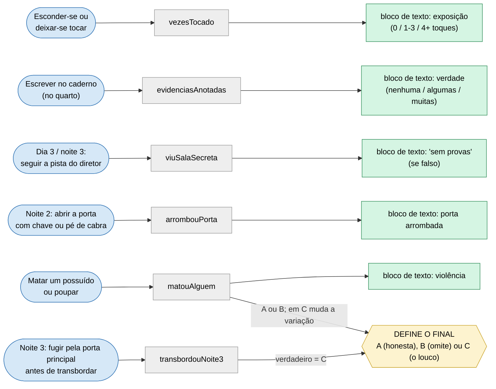
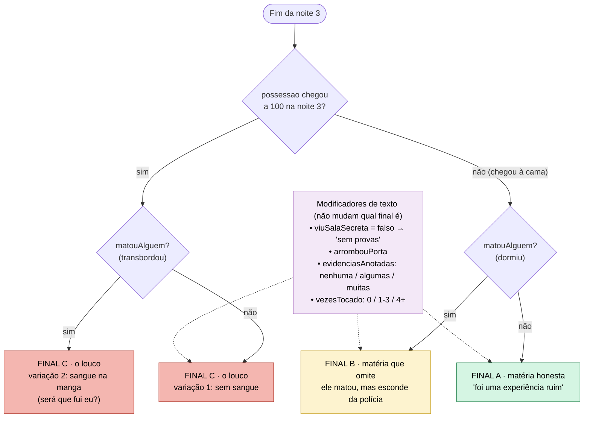

<!-- VIGÍLIA · GDD v0.2 (10/11/2026). Baseado no GDD técnico v0.1 (22/10/2026); mudanças na tabela de 00-capa-e-status.md. -->

## 3. Árvore de decisão (consulta rápida)

Seção para quando ninguém lembrar de uma decisão. Leia da esquerda para a direita: **ação do jogador → flag que ela liga → o que muda no final e na matéria**. Os nomes das flags estão no glossário (seção 4) e na tabela da seção 14.1.

### 3.1 O que cada ação do jogador liga

_Figura 1 · Ações do jogador (azul), flags (cinza) e saídas (verde e amarelo). Versão em texto na tabela 3.3._

### 3.2 Como o final é escolhido

> No original, as setas tracejadas dos modificadores vão para todos os finais (C, B e A).

_Figura 2 · Árvore dos finais. O final é função apenas de transbordouNoite3 e matouAlguem; os modificadores só mudam blocos de texto._

### 3.3 Versão em texto: regra de resolução do final

|**Regra**|**transbordouNoite3**|**matouAlguem**|**Final**|**Variação**|
|---|---|---|---|---|
|R-1|falso|falso|A · matéria honesta|—|
|R-2|falso|verdadeiro|B · matéria que omite|—|
|R-3|verdadeiro|falso|C · o jornalista é o louco|variação 1: sem sangue|
|R-4|verdadeiro|verdadeiro|C · o jornalista é o louco|variação 2: sangue na manga (“fui eu?”)|

Modificadores (não mudam o final, só acrescentam blocos de texto à matéria): `viuSalaSecreta = falso` acrescenta o bloco “sem provas”; `arrombouPorta = verdadeiro` acrescenta o bloco “porta arrombada”; `evidenciasAnotadas` escolhe o bloco de verdade (nenhuma, algumas, muitas); `vezesTocado` escolhe o bloco de exposição (0, 1 a 3, 4 ou mais).

### 3.4 Cola rápida: escolha → consequência → efeito no final

|**Momento**|**Escolha do jogador**|**Consequência imediata**|**Efeito no final**|
|---|---|---|---|
|Qualquer noite|Matar um possuído (ou poupar)|matouAlguem = verdadeiro; npcMorto[id] = verdadeiro; no dia seguinte os NPCs negam que a pessoa existiu. Repetir a noite (checkpoint) desfaz a morte|Final B se dormir na noite 3; Final C variação 2 se transbordar na noite 3|
|Qualquer noite|Esconder-se ou ser tocado|Cada toque soma +25 em possessao e incrementa vezesTocado|Só texto: bloco de exposição|
|Qualquer noite, no quarto|Escrever no caderno|Evidências coletadas viram evidenciasAnotadas (P-07); ativa o estado lúcido (× 0.5 por 60 s)|Só texto: bloco de verdade|
|Noite 1|Achar o cobertor|temCobertor = verdadeiro; o quarto fica quente; passa a ser possível dormir (P-05)|Nenhum direto|
|Noite 2|Abrir a porta com chave ou pé de cabra|Chave: gasta tempo. Pé de cabra: rápido, +10 em possessao, arrombouPorta = verdadeiro|Só texto: bloco “porta arrombada”|
|Dia 3 e noite 3|Seguir a pista do diretor até a sala secreta|viuSalaSecreta = verdadeiro|Só texto: sem esta flag a matéria sai “sem provas”|
|Noite 3|Entrar na sala secreta, encontrar o monstro e fugir pela porta principal antes de transbordar (v0.2)|Sair leva a A ou B. Transbordar leva a C (a noite 3 não repete)|Decide A ou B versus C|
