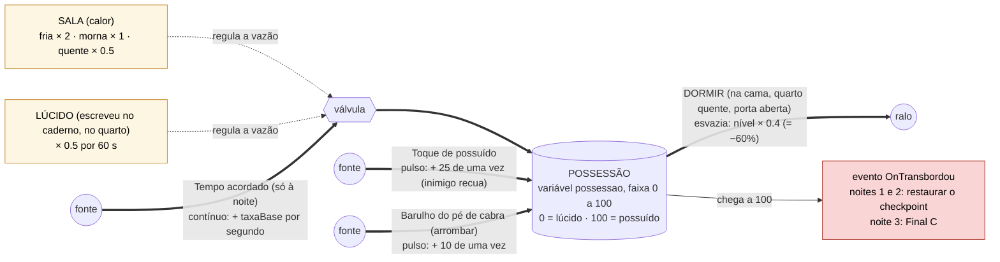

<!-- VIGÍLIA · GDD v0.2 (10/11/2026). Baseado no GDD técnico v0.1 (22/10/2026); mudanças na tabela de 00-capa-e-status.md. -->

## 6. A banheira (possessao)

### 6.1 O que ela mede

A banheira **quantifica o quanto Elias já está possuído**. É uma única variável, `possessao`, de 0 a 100. Pense numa banheira: o nível da água é a possessão, e se a água transbordar (100) o espírito vence. Ela não é “vida”: não existe barra de vida. Existe só o risco de ser possuído.

- **Torneiras (enchem):** tempo acordado à noite, toque de possuído, barulho do pé de cabra.

- **Registros (regulam a vazão da torneira do tempo):** a temperatura da sala (fria dobra, quente divide por dois) e o estado lúcido depois de escrever no caderno.

- **Ralo (esvazia):** dormir, que reduz o nível em 60%.

- **O calor e o sono não são barras separadas.** O sono é uma ação que esvazia; o calor é uma condição que muda a velocidade com que a água sobe.

- **Como o jogador vê o nível (P-10):** sem barra de HUD. O mundo avisa: vinheta escura nas bordas da tela, olheira no retrato de Elias, batimento sonoro e tremor da lanterna crescem com o nível. A barra opcional fica em aberto (Q-13).

### 6.2 Diagrama de estoque e fluxos

> **Herança:** ao dormir, o que sobra (40% do nível) passa para a noite seguinte. Se transbordar nas noites 1 e 2, a noite recomeça com o valor que tinha no início dela (checkpoint).

_Figura 3 · Estoque e fluxos da possessão. Versão em texto na tabela 6.3._

### 6.3 Versão em texto: fluxos

|**Fluxo**|**Tipo**|**Efeito em possessao**|**Valor inicial**|**Status**|
|---|---|---|---|---|
|Tempo acordado (só à noite)|contínuo|+ taxaBase × multSala × multLucido por segundo|taxaBase 0.10 por segundo **TESTE**|**DECIDIDO** (existe); **PROPOSTA** (só à noite, P-04)|
|Frio ou calor da sala|multiplicador|fria × 2, morna × 1, quente × 0.5 sobre a vazão base|multFria 2.0, multMorna 1.0, multQuente 0.5 **TESTE**|**DECIDIDO**|
|Toque de possuído|pulso|+ pulsoToque de uma vez; o inimigo recua|pulsoToque 25 **TESTE**|**DECIDIDO**|
|Barulho do pé de cabra (arrombar)|pulso|+ pulsoBarulho de uma vez; arrombouPorta = verdadeiro|pulsoBarulho 10 **TESTE**|**PROPOSTA** (P-03)|
|Escrever no caderno (lúcido)|multiplicador temporário|multLucido sobre a vazão base por duracaoLucido|multLucido 0.5; duracaoLucido 60 s **TESTE**|**DECIDIDO**|
|Dormir|esvazia|possessao passa a possessao × fatorSono|fatorSono 0.4 (esvazia 60%)|**DECIDIDO** (60%, D-09)|

### 6.4 Cálculo a cada quadro e exemplo numérico

Ordem de operações no PossessionMeter, a cada quadro, quando for noite:

- 1. calcular multSala (da sala atual) e multLucido (1.0 ou o valor do estado lúcido);

- 2. possessao = possessao + taxaBase × multSala × multLucido × dt;

- 3. limitar o valor ao intervalo de 0 a 100;

- 4. se possessao ≥ 100 e ainda não transbordou nesta noite: disparar OnTransbordou uma única vez.

**Exemplo.** Elias termina a noite 1 com possessao 70 e dorme: 70 × 0.4 = **28**. A noite 2 começa com 28. Com taxaBase 0.10 por segundo, em sala morna sobe 6 por minuto, em sala fria 12 por minuto e em sala quente 3 por minuto. Se levar um toque (+25) e chegar à cama com 63, dormir deixa 25.2 para a noite 3. Quem jogou bem acorda leve; quem foi tocado muitas vezes carrega uma cicatriz. Isso torna o “único que não reseta” uma mecânica.

### 6.5 Transbordar e checkpoint

|**Situação**|**O que acontece**|**Status**|
|---|---|---|
|Início de cada noite|O NightManager captura o SaveSnapshot: possessao, itens, flags, posições e NpcMemory (cópia profunda).|**DECIDIDO**|
|Transbordar nas noites 1 e 2|Restaura o snapshot. Os dados ficam iguais aos do início da noite, inclusive mortes e itens, e a noite recomeça. Mostrar feedback claro (tela e som) antes de repetir.|**DECIDIDO**|
|Transbordar na noite 3|Não repete. Leva ao Final C.|**PROPOSTA** (P-02)|
|Dormir|possessao × 0.4. Às 06:00 NpcMemory é zerada. WorldState é mantido. Começa o dia seguinte.|**DECIDIDO**|
|Entre noites|possessao acumula (herda o que sobrou). Não há teto de herança: com fatorSono 0.4, o máximo herdado é 40.|**DECIDIDO**|

### 6.6 Proteções contra espiral da morte (rubrica 11)

- O checkpoint é no **início** da noite, então repetir nunca começa pior do que a noite começou.

- Dormir esvazia 60%, então herdar nunca passa de 40 e sempre há margem para vencer a noite seguinte.

- A noite não tem cronômetro: ela só acaba por sono ou transbordo. Como a possessão sobe com o tempo, o jogador não consegue ficar parado para sempre sem consequência.

- Na noite 2 há uma sala quente (aquecedor) no caminho, para o jogador nunca ficar a noite inteira sem alívio.

### 6.7 Condição para dormir (P-05) e por que Elias sai do quarto

Proposta **PROPOSTA**: **só é possível dormir com o quarto quente e a porta aberta**. É isso que obriga Elias a sair do quarto: na noite 1 o quarto é frio por falta de cobertor; na noite 2 ele fica trancado fora. A noite 3 ainda não tem o motivo definido (Q-17). Sugestão para o grupo avaliar: a caldeira falha, o quarto esfria, e religá-la exige ir ao subsolo, onde está a sala secreta do diretor.
