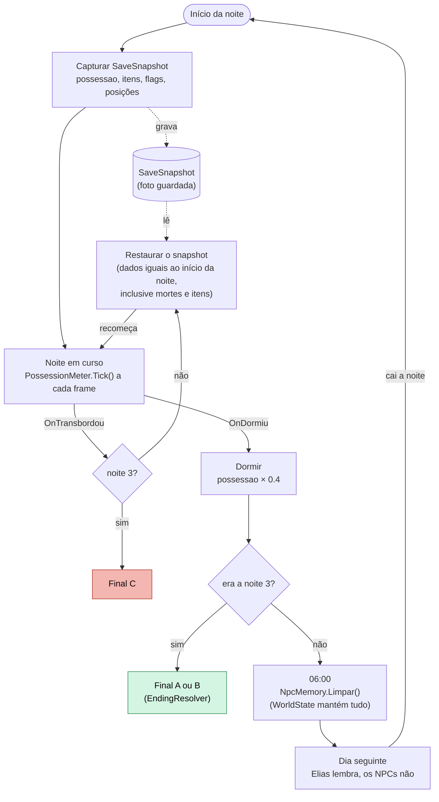

<!-- VIGÍLIA · GDD v0.2 (10/11/2026). Baseado no GDD técnico v0.1 (22/10/2026); mudanças na tabela de 00-capa-e-status.md. -->

## 8. Dia, noite e memória

### 8.1 O dia

O dia é um hub tranquilo **DECIDIDO**: os funcionários são inofensivos, conversam de forma esquisita e às vezes seguem Elias. Não há perseguição. Proposta **PROPOSTA** (P-04): possessao não sobe de dia. Elias explora, conversa, coleta pistas e pode escrever no caderno, mas só no quarto. Como o dia termina (tempo ou ação) está em aberto (Q-18). Dias são baratos de produzir; a ação fica nas noites.

### 8.2 Dois cadernos: o mundo lembra, os NPCs esquecem

||**WorldState (mundo)**|**NpcMemory (memória dos NPCs)**|
|---|---|---|
|O que guarda|Fatos reais: matouAlguem, npcMorto, itens, evidências, flags de pista|O que cada NPC sabe ter visto ou ouvido|
|Reset às 06:00|Nunca|Sempre (NpcMemory.Limpar())|
|Quem lê|EndingResolver, DialogueSystem, EnemyAI, SleepController|DialogueSystem|
|Quem escreve|EnemyAI, Notebook, gatilhos de pista, portas, itens|DialogueSystem e eventos que um NPC presenciou|
|No SaveSnapshot|Sim|Sim|

### 8.3 Regra de diálogo

O DialogueSystem escolhe a linha combinando os dois cadernos: se um fato existe em WorldState mas o NPC não o tem em NpcMemory, ele age como se nunca tivesse acontecido. Se `npcMorto[x]` é verdadeiro, os NPCs de dia negam que x existiu (“Dr. Almeida? Não conheço nenhum Almeida”). O estranhamento do jogador vira pista. As falas de cada NPC para cada fato são trabalho de roteiro (Q-19).

### 8.4 Ciclo da noite: checkpoint, transbordo, sono e reset

_Figura 5 · Ciclo de uma noite. Versão em texto nas tabelas 6.5 e 9.1._
