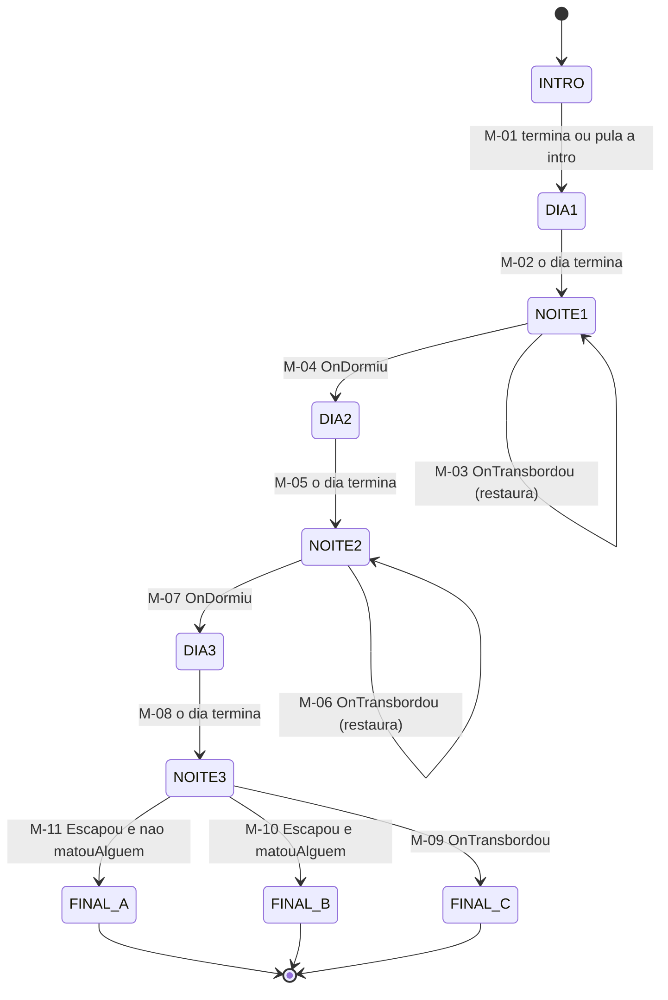
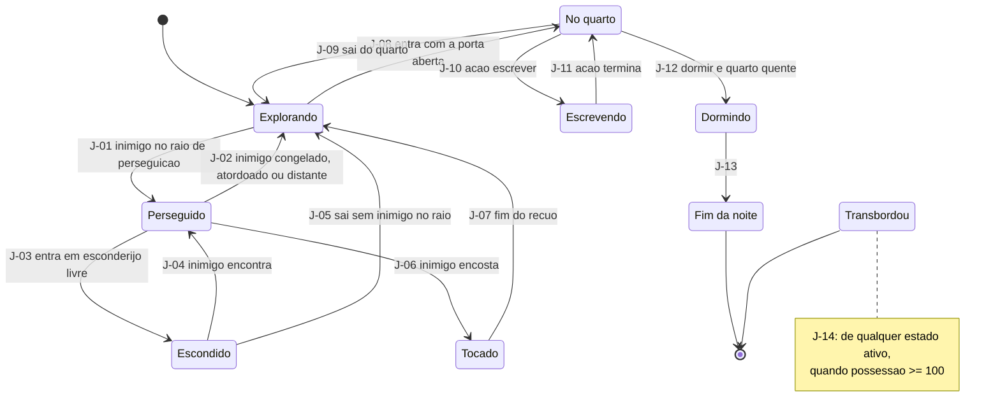
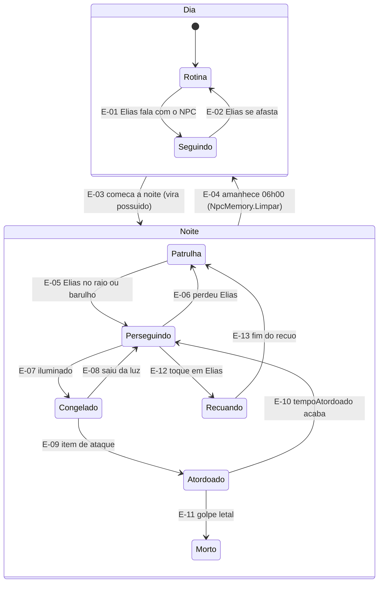

<!-- VIGÍLIA · GDD v0.2 (10/11/2026). Baseado no GDD técnico v0.1 (22/10/2026); mudanças na tabela de 00-capa-e-status.md. -->

## 9. Máquinas de estado

Há três máquinas encaixadas, como três mapas de metrô: o **macro** (o fim de semana), a do **jogador dentro de uma noite** e a de **cada inimigo**. Cada estado é uma estação e cada seta é uma transição com condição. As máquinas só **leem** o caderno de fatos (WorldState); o final é uma função dele. Implementação sugerida: um `enum` de estados, um `switch` e um método `MudarEstado(novo)` com ações de entrada e saída. Refatore para outro padrão só depois de funcionar.

### 9.1 Máquina macro (o fim de semana)

_Figura 6 · Máquina macro. Dias são hubs; noites são a ação; transbordar nas noites 1 e 2 repete a noite._

#### Versão em texto: transições da máquina macro

|**ID**|**De**|**Para**|**Condição**|**Efeito**|
|---|---|---|---|---|
|M-01|INTRO|DIA 1|jogador termina ou pula a intro|WorldState inicial; noiteAtual = 1|
|M-02|DIA 1|NOITE 1|o dia termina (Q-18)|capturar SaveSnapshot|
|M-03|NOITE 1|NOITE 1|OnTransbordou|restaurar SaveSnapshot e recomeçar a noite|
|M-04|NOITE 1|DIA 2|OnDormiu|possessao × fatorSono; NpcMemory.Limpar() às 06:00; noiteAtual = 2|
|M-05|DIA 2|NOITE 2|o dia termina|capturar SaveSnapshot|
|M-06|NOITE 2|NOITE 2|OnTransbordou|restaurar SaveSnapshot e recomeçar a noite|
|M-07|NOITE 2|DIA 3|OnDormiu|possessao × fatorSono; NpcMemory.Limpar(); noiteAtual = 3|
|M-08|DIA 3|NOITE 3|o dia termina|capturar SaveSnapshot|
|M-09|NOITE 3|FINAL C|OnTransbordou|transbordouNoite3 = verdadeiro; EndingResolver|
|M-10|NOITE 3|FINAL B|Escapou (saiu pela porta principal na fuga, v0.2) e matouAlguem = verdadeiro|EndingResolver|
|M-11|NOITE 3|FINAL A|Escapou (saiu pela porta principal na fuga, v0.2) e matouAlguem = falso|EndingResolver|

### 9.2 Jogador dentro de uma noite

_Figura 7 · Estados do jogador durante uma noite (possessao menor que 100)._

#### Versão em texto: transições do jogador

|**ID**|**De**|**Para**|**Condição**|**Efeito**|
|---|---|---|---|---|
|J-01|Explorando|Perseguido|algum inimigo entra no raio de perseguição|—|
|J-02|Perseguido|Explorando|inimigo congelado, atordoado ou distante|—|
|J-03|Perseguido|Escondido|Elias entra em esconderijo livre (Q-07)|inimigos perdem o alvo|
|J-04|Escondido|Perseguido|inimigo encontra (barulho ou tempo máximo, Q-07)|—|
|J-05|Escondido|Explorando|Elias sai e nenhum inimigo está no raio|—|
|J-06|Perseguido|Tocado|inimigo encosta em Elias|AdicionarPossessao(pulsoToque); vezesTocado + 1; inimigo vai a Recuando|
|J-07|Tocado|Explorando|fim do recuo|—|
|J-08|Explorando|No quarto|Elias entra no quarto com a porta aberta|inimigos não entram (P-06)|
|J-09|No quarto|Explorando|Elias sai do quarto|—|
|J-10|No quarto|Escrevendo|ação escrever|evidenciasColetadas passam a evidenciasAnotadas; lúcido por duracaoLucido|
|J-11|Escrevendo|No quarto|ação termina|—|
|J-12|No quarto|Dormindo|ação dormir e quarto quente (P-05)|dispara OnDormiu|
|J-13|Dormindo|Fim da noite|—|possessao × fatorSono; amanhecer 06:00|
|J-14|qualquer estado ativo|Transbordou|possessao ≥ 100|dispara OnTransbordou; noites 1 e 2 restauram checkpoint, noite 3 leva ao Final C|

### 9.3 Inimigo (funcionário possuído e paciente velho)

> E-03 vai de Rotina ou Seguindo para **Patrulha**; E-04 vai de qualquer estado da noite para **Rotina**.

_Figura 8 · Estados do inimigo. De dia é inofensivo; à noite é possuído._

#### Versão em texto: transições do inimigo

|**ID**|**De**|**Para**|**Condição**|**Efeito**|
|---|---|---|---|---|
|E-01|Rotina|Seguindo|Elias fala com o NPC (ou o NPC decide seguir)|conversa estranha|
|E-02|Seguindo|Rotina|Elias se afasta|—|
|E-03|Rotina ou Seguindo|Patrulha|começa a noite|vira possuído|
|E-04|qualquer estado da noite|Rotina|amanhece às 06:00|NpcMemory.Limpar(): esquece tudo|
|E-05|Patrulha|Perseguindo|Elias no raio de detecção ou barulho|—|
|E-06|Perseguindo|Patrulha|perdeu Elias (esconderijo ou distância)|—|
|E-07|Perseguindo|Congelado|iluminado: alcance, ângulo, sem parede, bateria maior que 0|para de andar|
|E-08|Congelado|Perseguindo|saiu da luz|—|
|E-09|Congelado|Atordoado|item de ataque (Q-04)|—|
|E-10|Atordoado|Perseguindo|tempoAtordoado acaba|—|
|E-11|Atordoado|Morto|golpe letal (Q-04)|matouAlguem = verdadeiro; npcMorto[id] = verdadeiro|
|E-12|Perseguindo|Recuando|encosta em Elias (toque)|Elias recebe pulsoToque|
|E-13|Recuando|Patrulha|fim do recuo|—|
