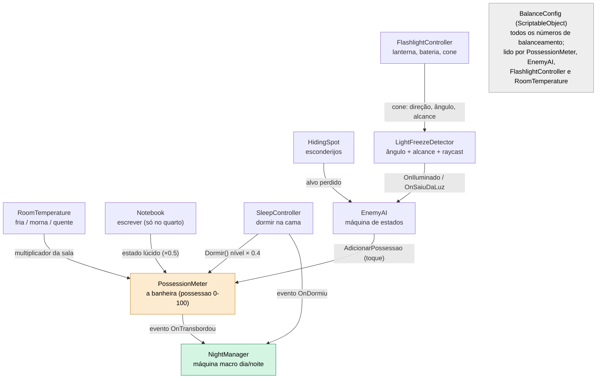
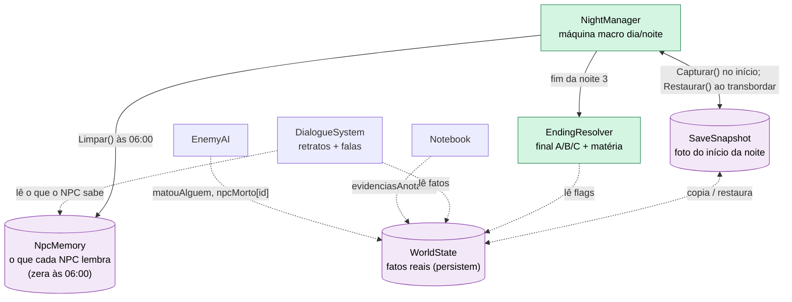

<!-- VIGÍLIA · GDD v0.2 (10/11/2026). Baseado no GDD técnico v0.1 (22/10/2026); mudanças na tabela de 00-capa-e-status.md. -->

## 13. Arquitetura de código

### 13.1 Módulos e eventos



_Figura 9 · Sistemas de gameplay. Todas as influências sobre a possessão passam pelo PossessionMeter._



_Figura 10 · Dados e ciclo. O NightManager é o único que captura, restaura e zera._

### 13.2 Versão em texto: módulos

|**Módulo**|**Responsabilidade**|**Lê**|**Escreve ou emite**|
|---|---|---|---|
|PossessionMeter|Guarda possessao. Única autoridade sobre o valor. Aplica multiplicadores, limita a 0 a 100.|BalanceConfig, RoomTemperature, Notebook (lúcido)|evento OnTransbordou; AdicionarPossessao(float); Dormir(); DefinirValor(float)|
|RoomTemperature|Atributo TemperaturaSala por sala; expõe o multiplicador da sala atual.|BalanceConfig, WorldState.temCobertor|—|
|FlashlightController|Liga e desliga, direção, bateria, cone.|BalanceConfig, entrada|consome bateria; expõe cone|
|LightFreezeDetector|Decide se cada inimigo está iluminado (4 condições).|cone, posições, colisores|eventos OnIluminado e OnSaiuDaLuz por inimigo|
|EnemyAI|Máquina de estados do inimigo (seção 9.3).|LightFreezeDetector, HidingSpot, BalanceConfig|AdicionarPossessao (toque); WorldState.matouAlguem e npcMorto|
|HidingSpot|Esconderijo que faz o inimigo perder o alvo.|—|alvo perdido|
|Notebook|Ação de escrever (só no quarto).|WorldState.evidenciasColetadas|WorldState.evidenciasAnotadas; estado lúcido|
|SleepController|Ação de dormir (quarto quente, porta aberta).|RoomTemperature, WorldState|PossessionMeter.Dormir(); evento OnDormiu|
|NightManager|Máquina macro dia e noite; captura e restaura o snapshot; reset das 06:00.|PossessionMeter, SleepController|SaveSnapshot, NpcMemory.Limpar(), EndingResolver|
|SaveSnapshot|Cópia profunda do estado no início da noite.|WorldState, NpcMemory, posições|restaura tudo|
|WorldState|Fatos reais (seção 14.1).|—|—|
|NpcMemory|O que cada NPC lembra. Zera às 06:00.|—|—|
|DialogueSystem|Retratos e falas; escolhe linhas por WorldState e NpcMemory.|WorldState, NpcMemory|NpcMemory (o que o NPC presenciou)|
|EndingResolver|Função pura: WorldState e transbordouNoite3 geram final e blocos da matéria.|WorldState|texto da matéria|
|BalanceConfig|ScriptableObject com todos os números (seção 14.2).|—|—|

### 13.3 Especificação dos módulos centrais (assinaturas, não implementação)

As assinaturas abaixo fixam o contrato. O corpo é implementado com o Claude Code, em passos pequenos.

```csharp
public class PossessionMeter : MonoBehaviour
{
    public float Valor { get; private set; }        // possessao, 0..100
    public event System.Action OnTransbordou;       // dispara 1 vez por noite
    public void AdicionarPossessao(float x);        // pulsos: toque, barulho
    public void Dormir();                           // Valor = Valor * cfg.fatorSono
    public void DefinirValor(float v);              // so para SaveSnapshot.Restaurar
    // Update(): se for noite, Valor += cfg.taxaBase * multSala * multLucido * dt
}
public static class EndingResolver
{
    // funcao total: nunca lanca excecao, nunca devolve lista vazia
    public static (FinalMateria final, List<BlocoTexto> blocos)
        Resolver(WorldState w, bool transbordouNoite3)
    {
        FinalMateria f = transbordouNoite3 ? FinalMateria.Louco
                       : w.matouAlguem     ? FinalMateria.Omite
                       :                     FinalMateria.Honesta;
        // blocos: Manchete(f, w.matouAlguem), Verdade(w.evidenciasAnotadas.Count),
        //         Violencia(w.matouAlguem), Exposicao(w.vezesTocado),
        //         + M-porta se w.arrombouPorta, + M-sem-provas se !w.viuSalaSecreta
    }
}
```

```csharp
public class SaveSnapshot
{
    public void Capturar(WorldState w, NpcMemory m, PosicoesDaCena p);  // COPIA PROFUNDA
    public void Restaurar(WorldState w, NpcMemory m, PosicoesDaCena p);
}
```

Cuidado clássico: copiar o estado por **referência** em vez de por valor faz o snapshot mudar junto com o jogo e o checkpoint “restaurar” o estado errado. Use cópia profunda.

### 13.4 Restrições do WebGL

- **Sem threads reais e sem acesso direto a arquivos.** Persistir com PlayerPrefs ou JsonUtility + PlayerPrefs (vai para o IndexedDB do navegador). Proposta P-13: guardar o checkpoint para “continuar” do início da última noite.

- **Áudio só toca depois de um clique** (política dos navegadores): ter uma tela inicial com botão “Jogar”.

- **Light 2D (URP) pode se comportar diferente no navegador.** Fazer um build WebGL já na sprint 1. Limite de luzes: 1 lanterna e poucas fixas; evitar luz por inimigo.

- **Tamanho do build:** retratos em atlas, texturas comprimidas, áudio comprimido. Testar o build enviado ao itch.io (projeto privado) cedo. Se não carregar, testar Decompression Fallback ou desativar a compressão nas configurações de publicação.

- **Botão “Sair do jogo” não faz sentido em WebGL.** Trocar por “Voltar ao menu” (a rubrica 4 espera funcionalidades básicas de menu).

- Testar em Chrome e Firefox.

### 13.5 Convenções

- Identificadores em português sem acento, camelCase; classes em PascalCase; eventos com prefixo On (P-14).

- Todos os números em BalanceConfig. Nada de número mágico no código.

- Cenas sugeridas: Boot (libera áudio), Menu, Intro, Jogo (dia e noite no mesmo mapa), Final.
